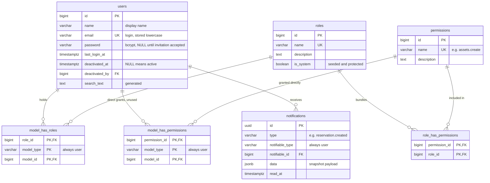
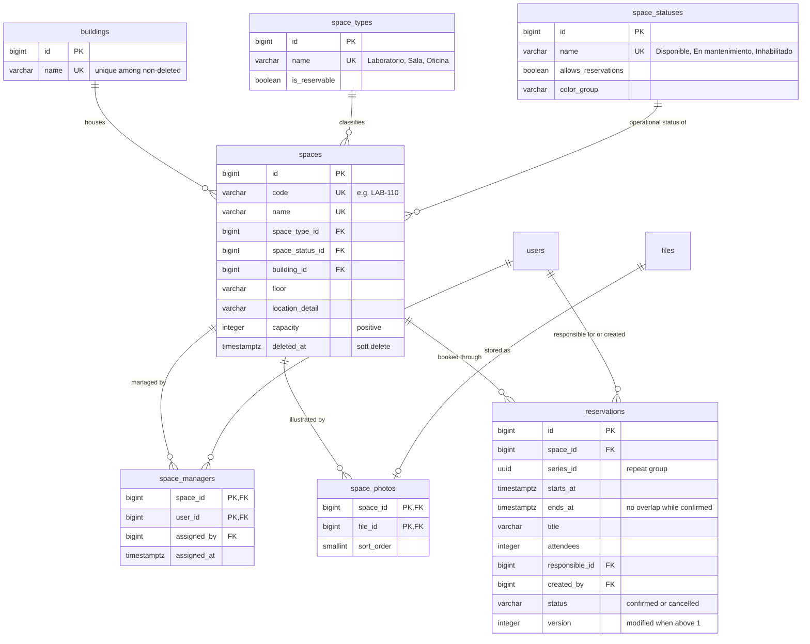
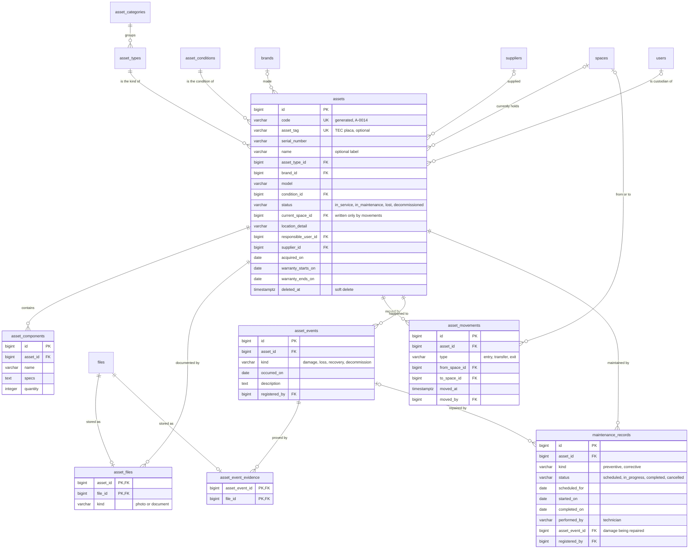
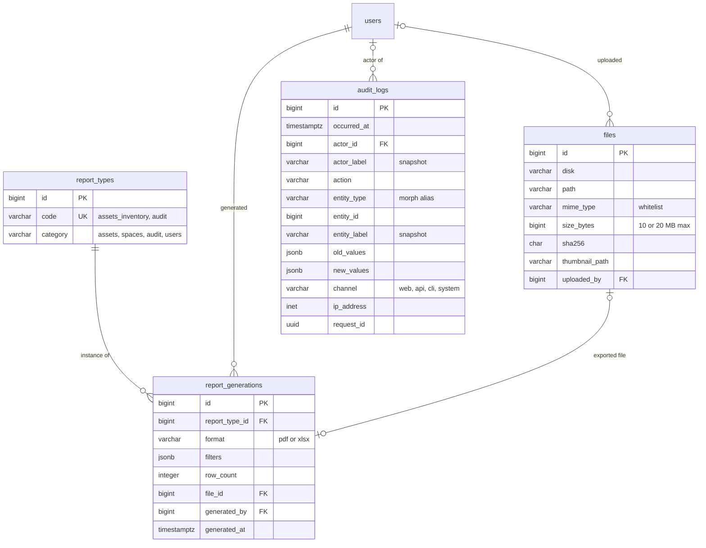

# Agent-DB.md: SETI Assets & Spaces data model

> **Status:** approved design (Stage 1, 2026-09-28), implemented as Laravel migrations (Stage 2, 2026-09-29).
> **Source of truth:** `database/migrations/` (ADR-0013). `docs/db/schema.sql` and `docs/db/seed.sql` are the frozen
> design references the migrations were generated from; `docs/db/smoke-test.sql` (111 checks) must keep passing on a
> migrated database. Vocabulary: `CONTEXT.md`. Hard-to-reverse decisions: `docs/adr/`.

---

## 1. Purpose and how to use this document

This document explains the relational model of the SETI Assets & Spaces system and, above all, **why it has this
shape**. It is written for the AI agents (Claude Code, Codex) and the five students who will build the Laravel
application on top of it.

| You need… | Go to |
|---|---|
| What a domain word means (Activo, Baja, Encargado…) | `CONTEXT.md` |
| The exact tables, constraints, triggers and views | `database/migrations/` (raw SQL, commented); the original DDL is `docs/db/schema.sql` |
| Why something is the way it is | This file; the short form of the hardest decisions is in `docs/adr/` |
| To implement a requirement | Find it in §21, read the module section it points to, follow §16 |
| To change the model | Add a migration (never edit a merged one), keep `smoke-test.sql` passing, update this file, and add an ADR if the change is hard to reverse |

**Verify the model** on a freshly migrated database without demo data (the test database works; the smoke test
rolls itself back):

```bash
docker compose exec -e APP_ENV=testing -e DB_DATABASE=seti_testing app php artisan migrate:fresh --seed
docker compose exec -T pgsql psql -U seti -d seti_testing -v ON_ERROR_STOP=1 < database/sql/ops/create-powerbi-reader.sql
docker compose exec -T pgsql psql -U seti -d seti_testing -v ON_ERROR_STOP=1 < docs/db/smoke-test.sql
# → 111 "ok" lines, then "ALL SMOKE TESTS PASSED". CI runs the same check on every pull request.
```

This needs PostgreSQL ≥ 16 with the contrib extensions `btree_gist`, `pg_trgm` and `unaccent`, a role that may create
extensions and roles, and a UTF-8 database with an ICU or UTF-8 locale (the reference run used ICU `es-CR`).

**How this design was produced.** Everything relevant was read in full: the Project Charter;
`Análisis-y-Diseño-completo.pdf` (RF_00–RF_101, user stories, use cases with required fields, process diagrams,
mockups); and `Backlog-y-sprint-1.pdf`. Then 34 decisions were put to the project manager in two rounds, each with
a recommended option (§20). Where the documents contradicted each other or the brief, the resolution is in §17.

---

## 2. Context and constraints

- **The system.** "Sistema de Activos y Tableros Administrativos de PowerBI para SETI" (TEC, Centro Académico de
  Alajuela). It centralizes the spaces SETI administers, the assets they contain, the reservations of those spaces,
  and reports/dashboards, all with authentication, role-based authorization and full traceability.
- **Non-negotiable stack.** PHP + Laravel over PostgreSQL. A responsive web app (phones, tablets, desktop).
  PowerBI dashboards are embedded in the app, alongside live in-app KPIs.
- **The team.** Five undergraduates helped by AI agents, over one semester. So the design follows Laravel
  conventions and well-known packages, and pushes invariants into **declarative database constraints**: a buggy code
  path cannot corrupt the data.
- **Scale** (from the mockups): about 1,300 assets, 22 spaces and tens of users. Live queries on a normalized schema
  are fast, so no counters or summary tables are needed.
- **Non-functional requirements that shape the schema:**
  - passwords are hashed and access goes through authenticated sessions;
  - every create, update, delete and report generation is audited (who, when, how), except changes made with direct SQL;
  - history is preserved (deactivating a user deletes nothing);
  - integrity holds: no double booking, and an asset is in exactly one place.
- **Priorities.** Sprint 1 covers RF_00_1–4, 01, 03, 04, 05, 07, 08, 32, 33, 35, 36, 42, 44, 45, 46, 51, 53, 54, 55,
  57, 60, 63, 64, 85, 89, 90, 91, 94, 95 and 100. The whole model is designed now, so later sprints add behavior, not
  restructuring.

---

## 3. Design principles

1. **Third normal form by default; redundancy only when named and guarded.** Every fact lives in one place. There
   are exactly three deliberate exceptions, each protected:
   - `assets.current_space_id` caches the movement log and is maintained by a trigger (ADR-0003);
   - notification payloads are snapshots (ADR-0006);
   - audit labels are snapshots (ADR-0002).
2. **The database enforces invariants; Laravel runs workflows.** Foreign keys, `UNIQUE`, `CHECK`, partial unique
   indexes and one `EXCLUDE` constraint hold whichever code path writes. Laravel handles permissions, friendly
   validation messages, side effects, notifications and auditing. Triggers do exactly two jobs (§14.8).
3. **History is never rewritten.** Movements, asset events and audit entries are append-only; a mistake is
   corrected with a new row. Anything that history points to is soft-deleted, and users are only deactivated.
4. **Derive, don't store, what time or other rows already tell you:** "occupied", "finished reservation",
   "modified reservation", "warranty valid", an asset's category, its display name.
5. **Laravel conventions and English identifiers.** Plural snake_case tables, `id` and `<singular>_id`,
   `created_at`/`updated_at`/`deleted_at`, and framework tables kept in their standard shape. Spanish appears only in
   the interface and in data values (catalog names).
6. **Reporting goes through a contract.** PowerBI and exports read `reporting.*` views, never the base tables.

---

## 4. The model at a glance

33 tables in `public` and 14 views in `reporting`.

| Module | Tables |
|---|---|
| Identity & access | `users`, `password_reset_tokens`, `sessions`, `personal_access_tokens`, `roles`, `permissions`, `model_has_roles`, `model_has_permissions`, `role_has_permissions` |
| Notifications | `notifications` |
| Catalogs | `buildings`, `space_types`, `space_statuses`, `asset_categories`, `asset_types`, `asset_conditions`, `brands`, `suppliers`, `report_types` |
| Spaces | `spaces`, `space_managers`, `space_photos` |
| Assets | `assets`, `asset_components`, `asset_files` |
| Asset history | `asset_movements`, `asset_events`, `asset_event_evidence`, `maintenance_records` |
| Reservations | `reservations` |
| Files & reports | `files`, `report_generations` |
| Audit | `audit_logs` |

### 4.1 Identity, access and notifications



`sessions`, `password_reset_tokens` and `personal_access_tokens` keep Laravel's default shape and are omitted from the
diagram.

### 4.2 Spaces and reservations



### 4.3 Assets and their history



### 4.4 Files, reports and audit



`audit_logs.entity_type`/`entity_id` point to any audited row through its morph alias. A generic audit log cannot
have a foreign key for that; `actor_id` does have one.

---

## 5. Identity, roles and access

**Tables:**
- `users`;
- `password_reset_tokens` (Laravel's password broker, used for both "forgot password" and invitations);
- `sessions` (database sessions);
- `personal_access_tokens` (Sanctum; reserved for a future non-browser client);
- the spatie/laravel-permission tables `roles`, `permissions`, `role_has_permissions`, `model_has_roles` and
  `model_has_permissions`.

**Why this shape:**

- **Email is the login (Q32).** The documents say "nombre de usuario" plus a separate "correo" (RF_00_1, CU_RF_91/93);
  the mockup and the brief say email. The docs' "nombre de usuario" became `users.name`, the display name. Emails are
  stored lowercase (`users_email_lowercase_check`), so a plain `UNIQUE` is case-insensitive and Laravel's `unique`
  rule works unchanged.
- **No password at creation; users get an invitation (Q21).** RF_91 creates a user from name, email and role only.
  `password` is `NULL` until the user follows a single-use emailed link (Laravel password broker; the token is stored
  hashed in `password_reset_tokens`) and sets it. Accepting the invitation also sets `email_verified_at`. Passwords are
  hashed with Laravel `Hash` (bcrypt).
- **Deactivate, never delete (RF_88, RF_98, Charter §1).** `deactivated_at`/`deactivated_by` revoke access; every
  foreign key into `users` stays valid forever. Laravel rejects login when `deactivated_at IS NOT NULL` and deletes that
  user's `sessions` rows, so access ends immediately.
- **Session auth, not JWT (Q19, ADR-0001).** For a browser app, HttpOnly session cookies can be revoked instantly,
  which RF_87/RF_88 require; stateless JWTs cannot.
- **Several roles per user, Discord-style (Q20, Q27, ADR-0008).** A user's permissions are the union of their roles'
  permissions. We added three things to Spatie's tables:
  - a real foreign key `model_has_roles.model_id → users` (and the same on `model_has_permissions`);
  - `CHECK (model_type = 'user')`, which forces the morph alias;
  - `roles.description` and `permissions.description` (RF_100), and `roles.is_system` for the seeded roles.
- **Roles.** Five system roles are seeded: Superusuario, Administrador, Reportes, Visualizador and **Reservante**.
  Reservante is new (Q28): it resolves RF_46 ("any user books") against RF_89 ("Visualizador is read-only"). The
  Superusuario may create custom roles, but only from the fixed permission catalog.
- **Rules kept in Laravel** (they span rows, so they are not declarative):
  - a user always holds at least one role (RF_86 cannot remove the last one);
  - the last active Superusuario can neither lose that role nor be deactivated;
  - `is_system` roles cannot be renamed or deleted;
  - RF_87 "modificar rol" swaps one role for another in one transaction.

**Initial role → permission matrix** (`seed.sql`; derived from each RF's actor; meant to be tuned).
★ = the Administrador's permission applies only to spaces they manage, and to the assets and reservations in those
spaces (§6).

| Permission | Superusuario | Administrador | Reportes | Visualizador | Reservante |
|---|:-:|:-:|:-:|:-:|:-:|
| `assets.view` | ✓ | ✓ | ✓ | ✓ | |
| `assets.create` · `assets.update` · `assets.delete` | ✓ | ✓★ | | | |
| `assets.move` · `assets.register_events` | ✓ | ✓★ | | | |
| `assets.manage_components` · `assets.manage_files` | ✓ | ✓★ | | | |
| `maintenance.view` | ✓ | ✓ | ✓ | ✓ | |
| `maintenance.manage` | ✓ | ✓★ | | | |
| `spaces.view` | ✓ | ✓ | ✓ | ✓ | ✓ |
| `spaces.create` | ✓ | ✓ | | | |
| `spaces.update` · `spaces.delete` · `spaces.manage_photos` | ✓ | ✓★ | | | |
| `spaces.assign_managers` | ✓ | | | | |
| `reservations.view` | ✓ | ✓ | ✓ | ✓ | ✓ |
| `reservations.create` · `reservations.manage_own` | ✓ | ✓ | | | ✓ |
| `reservations.manage_any` | ✓ | ✓★ | | | |
| `dashboards.view` | ✓ | ✓ | ✓ | | |
| `reports.view` · `reports.export` · `reports.audit` | ✓ | | ✓ | | |
| `reports.history` (RF_84) | ✓ | | | | |
| `users.view` | ✓ | ✓ | | | |
| `users.create` · `users.update` · `users.deactivate` | ✓ | | | | |
| `roles.view` · `roles.assign` · `roles.manage` | ✓ | | | | |
| `catalogs.manage` | ✓ | | | | |
| `brands.manage` · `suppliers.manage` | ✓ | ✓ | | | |

---

## 6. Spaces

**Tables:** `spaces`, `space_types`, `space_statuses`, `buildings`, `space_managers`, `space_photos`.

- **Identity.** `code` (short identifier, e.g. `LAB-110`, searched in RF_42) and `name` are both unique among
  non-deleted spaces, case-insensitively (the RF_32 diagram rejects duplicate names).
- **Location = building + floor + detail.** The Charter asks to filter spaces by location. A `buildings` lookup gives a
  clean filter, and `floor`/`location_detail` hold the rest. `building_id` is required (RF_32 requires "ubicación").
- **Capacity** is a positive integer (`spaces_capacity_check`, RF_36).
- **Type and operational status are editable lookups (Q12).**
  - `space_types.is_reservable`: Laboratorio and Sala yes, Oficina no.
  - `space_statuses`: Disponible, En mantenimiento, Inhabilitado, each with `allows_reservations` and a `color_group`
    for the badge.
  - **"Ocupado" is not a status.** It is computed from a confirmed reservation happening now
    (`reporting.spaces.is_occupied`), so it can never go stale.
- **A space is reservable** when `space_types.is_reservable AND space_statuses.allows_reservations AND deleted_at IS NULL`.
  This is the "¿está habilitado para reservar?" check in the RF_46 diagram. Changing a status that affects confirmed
  future reservations warns the user first (RF_44 diagram); any cancellations that follow notify as usual.
- **Space managers = "responsable" = "administrador asignado" (Q11, Q26, ADR-0009).** `space_managers` is many-to-many
  and works for any space type.
  - It drives what the space shows as responsible (RF_35, RF_64), who gets RF_48 notifications, and what an
    Administrador may touch: data, photos and status of their spaces; the assets in them; the reservations made in them.
  - Only holders of the Administrador role can be assigned (checked in Laravel), and removing that role removes their
    assignments.
  - When an Administrador creates a space (RF_32), they become its first manager; otherwise they could not edit it.
- **Deletion (RF_34) is a soft delete.** Laravel refuses it while the space holds in-service or in-maintenance assets,
  or has confirmed reservations that have not ended. Past reservations and movements keep pointing at the
  soft-deleted row, and its code and name become free for reuse.
- **Sorting** by creation or modification date (RF_37/RF_38) uses `created_at` and `updated_at`.
- **Photos (RF_41):** `space_photos` links to `files` (§11).

---

## 7. Assets

**Tables:** `assets`, `asset_categories`, `asset_types`, `asset_conditions`, `brands`, `suppliers`,
`asset_components`, `asset_files`.

### Identification (Q5)

| Column | Meaning |
|---|---|
| `id` | Internal key, never shown |
| `code` | Generated, always present: `'A-' || lpad(id, greatest(4, length(id)), '0')` gives `A-0014`, and `A-12345` past 9,999 (no truncation). It is the mockup's "ID". |
| `asset_tag` | The TEC inventory label ("placa"). Optional, because some items aren't tagged yet. Unique among non-deleted assets, case-insensitively. |
| `serial_number` | Manufacturer serial, optional |

### Classification (Q6, Q7)

- `asset_type_id → asset_types → asset_categories`. The asset stores only its type; the category is derived. Storing
  both would be a transitive dependency, and 3NF forbids it.
- Types answer "all monitors"; categories feed statistics (RF_81) and the mockup's donut chart. The Superusuario can
  add both (RF_24 diagram).
- `name` is an **optional label**. When it is blank, the display name is type + brand + model
  (`reporting.assets.display_name`, e.g. "Laptop Dell Latitude 5420"), which avoids duplicating brand and model
  inside a free-text name.
- `brand_id → brands` keeps the brand filter (RF_08) free of "Dell"/"DELL " duplicates; brands can be created inline
  from the asset form. `model` stays free text, because models are too varied to catalog. Both are nullable
  (furniture often has neither).

### Condition vs. lifecycle status (Q8, ADR-0004)

The documents' "estado" mixes two things, so there are two columns:

| Column | Values | Meaning |
|---|---|---|
| `condition_id → asset_conditions` | Buen estado (green), Regular (amber), Dañado (red), plus any the Superusuario adds | Physical condition. `color_group` is the "color for a group of conditions" (RF_05, RF_80). `condition_note` is RF_05's "descripción". |
| `status` | `in_service`, `in_maintenance`, `lost`, `decommissioned` | Where the asset is in its life. Lost and decommissioned assets are excluded from "available" (RF_28, RF_29). |

The inventory badge shows the lifecycle status when the asset isn't in service, and its condition color otherwise.

### Other attributes

- **Custodian (RF_23):** `responsible_user_id → users`. It is nullable, because RF_78 lists assets without one. When
  assigning, Laravel checks that the user is active (RF_23 diagram).
- **Acquisition:** `acquired_on` (RF_14) and `supplier_id → suppliers` (RF_15, "pick a registered supplier").
- **Warranty (RF_16, RF_17, RF_75):** `warranty_starts_on` and `warranty_ends_on`. Both or neither
  (`assets_warranty_pair_check`), and the end may not precede the start. "Has a warranty" means both are set; "valid"
  means the end is today or later (`reporting.assets.warranty_state`: none/valid/expired). The warranty provider is the
  asset's supplier.
- **Location (RF_18):** `current_space_id` (see §8; **never written directly**) plus an optional free-text
  `location_detail` such as "Rack 2" or "Escritorio 5".
- **`observations`** (RF_19): free text, may be empty.

### Delete vs. decommission (Q3)

"Eliminar activo" (RF_02) is a **soft delete** for records entered by mistake. The row disappears from lists but stays
joinable from history, and its tag becomes free. "Dar de baja" (RF_22, RF_29) is a **lifecycle event** (§8): the asset
stays listed with status `decommissioned`, and its history is kept forever. The two are never the same operation.

### Components and files

- **Components (RF_12, RF_31, RF_77):** `asset_components` holds `name`, `specs`, `serial_number`, `quantity > 0` and
  `notes`. These are internal parts that are never labeled or tracked on their own. Nothing points to a component, so
  deleting one is a hard delete; the audit log keeps its values.
- **Files (RF_20, RF_21):** `asset_files` holds (`asset_id`, `file_id`, `kind` photo/document, `sort_order`); see §11.

---

## 8. Asset history: movements, events and maintenance

### 8.1 Movements: where an asset has been (Q9, ADR-0003)

`asset_movements` is an **append-only** log of physical location changes:

| `type` | `from_space_id` | `to_space_id` | Used for |
|---|---|---|---|
| `entry` | NULL | required | Registering an asset in a space (RF_03), or bringing it back from outside |
| `transfer` | required | required, different | Moving between spaces (RF_06) |
| `exit` | required | NULL | Leaving SETI's spaces: external repair, loan, disposal |

`assets.current_space_id` is a **cache of the latest movement**. It keeps "assets in this space" (RF_56, the inventory
list) a plain indexed foreign key. The trigger `asset_movements_apply` is its only writer; before applying a movement
it:

1. locks the asset row, which serializes concurrent moves;
2. requires the movement to start where the asset is (`asset_movements_origin_matches`), so a second entry, or a
   transfer from the wrong space, is impossible (Charter §9, "asignar simultáneamente un activo a espacios
   incompatibles");
3. refuses deleted assets and lost assets, and allows decommissioned assets to exit only (`asset_movements_asset_rules`);
4. refuses moves into a deleted space (`asset_movements_destination_active`);
5. keeps history chronological: a movement may not predate the latest one (`asset_movements_chronological`);
6. then sets the pointer.

Any other write to `current_space_id` is rejected by the `assets_guard_location` trigger.

**How to use it:**
- **Register an asset in a space:** insert the asset (no location), then insert an `entry` movement, in one
  transaction.
- **Move an asset:** insert a `transfer`. Never update the column.
- A lost or decommissioned asset **keeps its last known space** ("lost from Lab 110"). Lists hide it by status. It
  leaves a space only through an `exit`.
- **Admin scope (Q26, RF_06).** An Administrador may transfer an asset out of a space they manage, to any active space.
  An asset outside every space (after an exit) is managed by Superusuarios and by the managers of the space it last
  left.

### 8.2 Asset events: what happened to an asset (Q24)

`asset_events` records, append-only, the dated facts that change an asset's condition or lifecycle status:

| `kind` | Requirement | Notes |
|---|---|---|
| `damage` | RF_13 | Description plus evidence photos/documents (`asset_event_evidence` → `files`) |
| `loss` | RF_28 | Date and description; the asset stops counting as available |
| `recovery` | — | A lost asset was found; it's back in service |
| `decommission` | RF_22, RF_29 | Date and **reason**; at most one per asset (`asset_events_one_decommission`); terminal |

RF_76's report ("baja vs pérdida") is simply `kind IN ('decommission','loss')`. A mistaken event is corrected with a new
event (for example a `recovery`), never by editing the old one.

### 8.3 Maintenance: work done or planned (Q10)

The documents' "mantenimiento correctivo" (RF_10) and "reparación" (RF_11) are the same thing: **a repair is corrective
maintenance**. So there is one table, `maintenance_records`:

| Column | Values and rules |
|---|---|
| `kind` | `preventive` (RF_26, periodic check) or `corrective` (RF_10, RF_11, a repair) |
| `status` | `scheduled` (needs `scheduled_for`, RF_27), `in_progress` (needs `started_on`), `completed` (needs `completed_on`; the reverse holds too), `cancelled` (may carry `cancellation_reason`) |
| `performed_by` | Who did the work (RF_10 "responsable"). Often an external technician, so it's free text. |
| `registered_by` | The user who recorded it (RF_10.3) |
| `asset_event_id` | The damage a corrective job fixes (RF_11). The composite FK `(asset_event_id, asset_id)` guarantees the damage belongs to **the same asset**, and only corrective work may reference one. |

RF_27's modify/cancel is a plain update of a `scheduled` row. The dashboard's "Mantenimientos pendientes" means
`status IN ('scheduled','in_progress')`. RF_66 and RF_82 separate maintenance from repairs by `kind`.

### 8.4 Side effects (Q25)

Laravel services apply these **in the same transaction**, audited under one `request_id`:

| Action | Rows written | Change to the asset |
|---|---|---|
| Register a damage (RF_13) | `asset_events(damage)` + evidence | condition → a red-group condition the user picks (default "Dañado"). This removes RF_13's circular "the asset must already be red". |
| Start corrective maintenance | `maintenance_records(corrective, in_progress)` | status → `in_maintenance` |
| Complete corrective maintenance (RF_11) | update → `completed` | status → `in_service`; the user picks the new condition ("en funcionamiento") |
| Cancel an in-progress corrective job | update → `cancelled` | status → `in_service`; condition unchanged |
| Register a loss (RF_28) | `asset_events(loss)` | status → `lost` |
| Register a recovery | `asset_events(recovery)` | status → `in_service` |
| Decommission (RF_29) | `asset_events(decommission)` | status → `decommissioned`. Terminal: no transfers, maintenance or components afterwards. |

Preventive maintenance doesn't change the status; it is usually done in place.

### 8.5 Asset history (RF_09) and space history (RF_39)

The history screens merge, newest first:
- **An asset:** its `asset_movements`, `asset_events`, `maintenance_records`, and `audit_logs` rows where
  `entity_type = 'asset' AND entity_id = :id`. The audit rows show field edits by Administradores and Superusuarios,
  with the old and new values.
- **A space:** its reservations, movements from or to it, and `audit_logs` rows where `entity_type = 'space'`.

---

## 9. Reservations

**Table:** `reservations`.

- **Shape (Q13).** One row is one space and one continuous `[starts_at, ends_at)` range. Repeating bookings (a course
  every Tuesday) are several rows sharing a `series_id`, created in one action; each date can be moved or cancelled
  on its own. RF_48's "fechas" (plural) is a series.
- **No double booking, even under concurrency (RF_46, Charter §9, ADR-0005):**

  ```sql
  CONSTRAINT reservations_no_overlap EXCLUDE USING gist (
      space_id WITH =, tstzrange(starts_at, ends_at, '[)') WITH &&) WHERE (status = 'confirmed')
  ```

  Back-to-back bookings (10:00–11:00 and 11:00–12:00) are allowed. Cancelled rows don't block, and un-cancelling can't
  recreate an overlap (both are covered by the smoke tests).
- **States (Q14).** Only `confirmed` and `cancelled` are stored; everything else is derived:

  | Document term | In the model |
  |---|---|
  | activa / Confirmada (mockup) | `status = 'confirmed'`, not yet finished; `effective_status` is `upcoming` or `in_progress` |
  | cancelada | `status = 'cancelled'`, with `cancelled_at`, `cancelled_by` and `cancellation_reason` (`reservations_cancellation_check` keeps them coherent) |
  | finalizada | `effective_status = 'finished'`, computed from `ends_at` (`reporting.reservations`), so no cron job is needed |
  | modificada | `was_modified = (version > 1)`. A label, not a state. The audit log keeps what changed. |
  | Pendiente (mockup) | **Not used.** There is no approval step. |

- **Who may book (Q28):** holders of `reservations.create`, i.e. Reservante, Administrador and Superusuario.
  Visualizador stays read-only (RF_89).
- **Rules in Laravel (Q29).** These come from the process diagrams and are validated with friendly messages:
  - the space is reservable (§6);
  - the booking falls inside the **allowed hours**, a global window in `config/` (placeholder: Monday–Saturday
    07:00–22:00, to be confirmed with SETI);
  - `attendees ≤ spaces.capacity` (the database only enforces `attendees > 0` and `ends_at > starts_at`);
  - only the responsible user or creator (`reservations.manage_own`), the space's managers or a Superusuario
    (`reservations.manage_any`) may modify or cancel;
  - reservations that are ongoing or past can't be modified or cancelled (RF_49/RF_50 diagrams).
- **Modifying (RF_49).** Update in place with `version = version + 1 … WHERE id = ? AND version = ?` (optimistic
  locking). The exclusion constraint re-checks the new time automatically.
- **"My reservations" (RF_52)** means `created_by = me OR responsible_id = me`.
- **Canonical availability check (RF_55).** It uses the same `[)` semantics as the constraint (tested):

  ```sql
  SELECT NOT EXISTS (
      SELECT 1 FROM reservations
      WHERE space_id = :space_id AND status = 'confirmed'
        AND tstzrange(starts_at, ends_at, '[)') && tstzrange(:starts_at, :ends_at, '[)')
        AND id IS DISTINCT FROM :reservation_being_modified   -- NULL when booking
  ) AS is_available;
  ```

- **Calendar (RF_45):** `reporting.reservations WHERE status = 'confirmed' AND starts_at < :month_end AND ends_at > :month_start`.
  `local_date` gives the Costa Rica calendar day.

---

## 10. Notifications

**Storage (Q15, ADR-0006).** Laravel's database notifications table, `notifications`: one row per recipient
(fan-out on write), with a JSONB `data` **snapshot** and `read_at` for the unread badge. The two additions are a real FK
`notifiable_id → users` and `CHECK (notifiable_type = 'user')`. Notifications are system-generated, so they are **not
audited** (per the brief).

**Delivery (Q16).** Every notification uses the `database` and `broadcast` channels. Laravel Reverb pushes it over a
WebSocket to the private channel `App.Models.User.{id}`, so the bell updates instantly on phones and desktops. The row in
the database is the source of truth: after a reconnect, the client re-reads its unread count
(`notifications_notifiable_id_created_at_index`). Dispatch **after commit** (`afterCommit()`), so a rolled-back
reservation never notifies anyone.

**Types.** Each class returns a stable `databaseType()`, so renaming a PHP class never breaks old rows:

| `type` | Trigger | Recipients |
|---|---|---|
| `reservation.created` | RF_46 → RF_47/RF_48 | Active Superusuarios + the space's managers |
| `reservation.updated` | RF_49 (diagram) | Same |
| `reservation.cancelled` | RF_50 (diagram) | Same |
| `maintenance.due` | Daily scheduler: scheduled maintenance due within N days, or overdue (RF_27; Q30) | Managers of the asset's current space |
| `asset.damage_reported`, `asset.loss_reported` | An `asset_events` row of kind damage/loss (Q30) | Managers of the asset's space + active Superusuarios |

Recipient rules (Q34):
- active users only, never the person who performed the action;
- one notification per action, so a whole series produces one notification that lists all its dates;
- a space without managers notifies only the Superusuarios.

Canonical recipient query (tested):

```sql
SELECT u.id FROM users u
WHERE u.deactivated_at IS NULL
  AND u.id <> :actor_id
  AND (EXISTS (SELECT 1 FROM model_has_roles mr JOIN roles r ON r.id = mr.role_id
               WHERE mr.model_type = 'user' AND mr.model_id = u.id AND r.name = 'Superusuario')
    OR EXISTS (SELECT 1 FROM space_managers m WHERE m.space_id = :space_id AND m.user_id = u.id));
```

Example payload for `reservation.created`:

```json
{
  "reservation_ids": [812, 813, 814],
  "series_id": "0b7c…",
  "space": { "id": 3, "code": "LAB-110", "name": "Laboratorio 110" },
  "dates": ["2026-10-06T10:00:00-06:00", "2026-10-13T10:00:00-06:00", "2026-10-20T10:00:00-06:00"],
  "title": "Tutoría grupal",
  "booked_by": { "id": 7, "name": "Beto Reservante" }
}
```

**Retention:** read notifications older than 180 days are pruned (`model:prune`). New notification types need no
migration.

---

## 11. Files

**Where the bytes live (Q17, ADR-0007).** Photos, documents, damage evidence and exported reports are stored on a
Laravel Storage disk, `config('filesystems.files_disk')`: the private `local` disk, which in production is a Docker
volume on the VM disk (ADR-0007 as amended). PostgreSQL stores one
`files` row per file:

| Column | Purpose |
|---|---|
| `disk`, `path` (unique together) | Where the bytes are |
| `original_name`, `mime_type`, `size_bytes` | What the user uploaded |
| `sha256` | Integrity and duplicate detection (64 lowercase hex characters, checked) |
| `width`, `height`, `thumbnail_path` | Images only; a ~400 px WebP thumbnail is generated on upload for phones |
| `uploaded_by` | The user, for audit and attribution |

**Rules enforced by the database:**
- **MIME whitelist:** `image/jpeg`, `image/png`, `image/webp`, `image/gif` and `application/pdf`, plus XLSX for exported
  reports only. HEIC is not accepted; iOS Safari converts photos to JPEG on upload.
- **Size limits:** images ≤ 10 MB, everything else ≤ 20 MB.

Laravel validates the same rules first, so users get friendly messages.

**Links (Q18).** Each file belongs to exactly one owner, through real foreign keys:

| Link | Owner | Requirement |
|---|---|---|
| `asset_files` (`kind` photo/document) | asset | RF_20, RF_21 |
| `space_photos` (`sort_order`, `caption`) | space | RF_41 |
| `asset_event_evidence` | damage/loss event | RF_13 |
| `report_generations.file_id` | exported report | RF_70, RF_71, RF_84 |

Each link table makes `file_id` unique. Exclusivity *across* link tables is enforced by Laravel.

**Deleting (Q3).** Attachments are hard-deleted: delete the `files` row, which cascades to its link row; the
application removes the bytes **after** the transaction commits, and the audit log records `detached`. Deleting an
exported file sets `report_generations.file_id` to NULL, so the generation record survives.

---

## 12. Audit trail

**Table:** `audit_logs`, written by Laravel **in the same transaction** as the change (Q4, Q33, ADR-0002). Triggers
reject `UPDATE`, `DELETE` and `TRUNCATE` (`audit_logs_append_only`), which satisfies RF_68's "conservar la información
registrada originalmente".

| Column | The "who / when / what / how" |
|---|---|
| `occurred_at` | When |
| `actor_id` (FK), `actor_label` | Who: the id plus a name snapshot. NULL for system jobs and failed logins. |
| `action` | What kind of operation (a fixed list; see below) |
| `entity_type`, `entity_id`, `entity_label` | Which element: the morph alias (`asset`, `space`, `user`, `reservation`…), the id, and a readable snapshot such as "A-0014 · Proyector Epson · Lab 110" (the dashboard's "Actividad reciente") |
| `old_values`, `new_values` | JSONB objects holding only the changed fields |
| `channel` | How: `web`, `api`, `cli` (artisan/imports) or `system` (queued jobs, scheduler) |
| `ip_address`, `user_agent` | From where, and on which device |
| `request_id` | Groups every row written by one user action. A transfer, for example, writes the movement and the asset update. |

**What is logged:**

| `action` | Emitted by | Entity |
|---|---|---|
| `created`, `updated`, `deleted`, `restored` | Eloquent events of every business model (RF_00_2, RF_00_3) | the model |
| `attached`, `detached` | A file added to or removed from an owner | the owner (asset, space, asset event) |
| `generated` | A report exported (RF_00_4, RF_70, RF_71) | `report_generation` |
| `role_assigned`, `role_removed` | RF_85–RF_87 (pivot changes fire no Eloquent events, so they are logged explicitly) | `user` |
| `manager_assigned`, `manager_removed` | RF_40, RF_43 (logged explicitly) | `space` |
| `login`, `logout`, `login_failed`, `password_set`, `password_reset` | Laravel auth events (Q33). `login_failed` stores the attempted email in `new_values`. | `user` (none for failures) |
| `deactivated`, `reactivated` | RF_88, RF_98 | `user` |

**Never audited:** notifications (system-generated), reads, and changes made with direct SQL (by design, per the
brief). **Never written into the audit log:** secrets. `password`, `remember_token` and tokens are excluded from
`old_values`/`new_values`; a password change is logged only as `password_set`/`password_reset`.

**Reads.**
- History screens (RF_09, RF_39) filter by entity.
- User activity (RF_99) filters `actor_id` plus a date range.
- The audit report (RF_68) filters by user, action and date range, through `reporting.audit_logs`.
- Indexes: `(occurred_at)`, `(actor_id, occurred_at)`, `(entity_type, entity_id, occurred_at)`,
  `(action, occurred_at)` and `(request_id)`.
- Audit rows are kept forever. At this scale that's fine; if they ever reach millions, partition by year.

---

## 13. Reports, dashboards and "real-time"

**One contract: the `reporting` schema (Q22, ADR-0010).** Stable, denormalized, secret-free views. PowerBI connects as
the `powerbi_reader` role, which has `USAGE` and `SELECT` on `reporting` only and cannot read `public.users`. The in-app
report module queries **the same views**, so the app and PowerBI always agree.

| View | Serves |
|---|---|
| `reporting.assets` | Inventory list and report (RF_63); warranty (RF_75); custodians (RF_78); state/category statistics (RF_80, RF_81); per-space report (RF_74) |
| `reporting.asset_components` | RF_77 |
| `reporting.spaces` | RF_35, RF_53, RF_64, RF_74. Includes `is_occupied`, `is_reservable`, `managers` and `asset_count`. |
| `reporting.space_managers` | RF_96, RF_97 |
| `reporting.reservations` | RF_45, RF_51, RF_52, RF_57, RF_65, RF_83. Includes `effective_status`, `was_modified` and `local_date`. |
| `reporting.space_occupancy` | RF_59, RF_79, RF_83: confirmed bookings, booked hours and attendees per space per local day (a booking counts on its start day) |
| `reporting.maintenance` | RF_66, RF_82. `kind` separates maintenance from repairs; `reference_date` is used for date filters. |
| `reporting.asset_movements` | RF_67, RF_09 |
| `reporting.asset_events` | RF_76 (decommission vs loss), RF_09 |
| `reporting.users`, `reporting.user_roles` | RF_69, RF_90, RF_92, RF_101. Includes `account_status` and `invitation_pending`; no hashes. |
| `reporting.audit_logs` | RF_68, RF_99. JSON is exposed as text and IPs as text, which PowerBI handles. |
| `reporting.report_generations` | RF_84 |
| `reporting.dashboard_kpis` | The mockup's cards: total assets, available spaces, today's reservations, pending maintenance |

**Conventions.**
- Status and kind columns hold the English codes; the UI and PowerBI translate them to Spanish labels.
- Time-of-day logic uses `reporting.local_tz()` (`America/Costa_Rica`, which has no DST), so "today" and `local_date`
  don't depend on the client's session time zone.

**Exports (RF_70–RF_72, RF_84; Q31).**
- Each export writes a `report_generations` row: `report_type_id` (catalog of 13 reports, `category` drives the RF_60
  menu), `format` (pdf/xlsx), `filters` (JSON object; `{}` means "all records", as RF_72 requires), `row_count`,
  `generated_by`, `generated_at`, and `file_id` for the stored file.
- Keeping the file lets anyone authorized re-download exactly what the report said that day.
- The generation is also audited (`generated`).

**"Real-time".**
- In-app dashboards and KPIs query the live views; at this size that takes milliseconds, and nothing can be stale.
- When data changes, a broadcast event (e.g. `dashboard.refresh`, via Reverb) tells open dashboards to refetch.
- PowerBI refreshes on its own schedule (RF_73): Import mode with scheduled refresh, or DirectQuery against the views.
- The "last updated" timestamp and the "could not refresh" message come from PowerBI's refresh history, not from our
  database.
- If a view ever becomes slow, turn it into a materialized view refreshed by the scheduler. Never add counters to base
  tables.

---

## 14. Cross-cutting conventions

### 14.1 Naming
English, plural snake_case tables; `<singular>_id` foreign keys; booleans `is_*` or `allows_*`; pure dates `*_on`;
instants `*_at`. Constraints are named `<table>_<purpose>_check|unique|foreign`, as in Laravel. Spanish appears only in
data values (catalogs, seeded descriptions) and the UI.

### 14.2 Keys
- `bigint` identity primary keys (Laravel `$table->id()`).
- Pure link tables use composite primary keys (`space_managers`, `asset_files`, the Spatie pivots).
- `notifications.id` is a UUID (Laravel default).
- Human-facing identifiers are separate unique columns: `assets.code`, `assets.asset_tag`, `spaces.code`.

### 14.3 Types
`varchar(n)` for bounded identifiers and names; `text` for descriptions; `jsonb` for payloads, diffs and filters;
`inet` for IPs; `uuid` for `series_id` and `request_id`; `char(64)` for SHA-256.

### 14.4 Time
- Every instant is `timestamptz`; every calendar date is `date` (the lint in the smoke test enforces this).
- Costa Rica is UTC−6 with no DST. The application time zone is `America/Costa_Rica`, and the Laravel `pgsql` connection
  uses the same `timezone` (§15), so PHP and PostgreSQL agree even on offset-less literals.
- SQL that needs "today" uses `reporting.local_tz()`.

### 14.5 Enumerations
Fixed, code-driven sets are `varchar` + `CHECK`, mirrored by a PHP backed enum. Sets that users may edit are lookup
tables (§4 catalogs). PostgreSQL `ENUM` types are not used, because they are painful to change in migrations.

| Column | Values |
|---|---|
| `assets.status` | `in_service`, `in_maintenance`, `lost`, `decommissioned` |
| `asset_movements.type` | `entry`, `transfer`, `exit` |
| `asset_events.kind` | `damage`, `loss`, `recovery`, `decommission` |
| `maintenance_records.kind` / `.status` | `preventive`, `corrective` / `scheduled`, `in_progress`, `completed`, `cancelled` |
| `reservations.status` | `confirmed`, `cancelled` |
| `asset_files.kind` | `photo`, `document` |
| `report_generations.format` | `pdf`, `xlsx` |
| `report_types.category` | `assets`, `spaces`, `audit`, `users` |
| `asset_conditions.color_group` / `space_statuses.color_group` | `green`, `amber`, `red` / `green`, `amber`, `red`, `gray` |
| `audit_logs.channel` | `web`, `api`, `cli`, `system` |
| `audit_logs.action` | see §12 |

### 14.6 Soft deletes and uniqueness
`deleted_at` (Laravel `SoftDeletes`) applies to catalogs, spaces and assets. Uniqueness is enforced by **partial unique
indexes on `lower(column)` `WHERE deleted_at IS NULL`**. This makes uniqueness case-insensitive, and a deleted record
frees its name, code or tag. Emails are the exception: they are stored lowercase, so a plain `UNIQUE` suffices. Laravel's
`unique` validation rule must add `whereNull('deleted_at')` for soft-deleted tables. Beyond that, rely on the
constraint and map its error (§14.11).

### 14.7 Search (RF_07, RF_42, RF_95)
- `assets`, `spaces` and `users` each have a `STORED` generated column `search_text`:
  `lower(immutable_unaccent(code || name || …))`, with a GIN `gin_trgm_ops` index.
- A query is `search_text LIKE '%' || lower(immutable_unaccent(:q)) || '%'`. It is partial-match and
  accent-insensitive ("salon" finds "Salón"), and it uses the trigram index (verified with `EXPLAIN`).
- Names from other tables (brand, type, building) are matched through a join.
- Escape `%` and `_` in user input.
- `immutable_unaccent()` exists because `unaccent()` is only `STABLE`, and generated columns need `IMMUTABLE`.

### 14.8 Triggers: exactly two jobs (Q2)

| Job | Triggers |
|---|---|
| Asset location (ADR-0003) | `asset_movements_apply` (BEFORE INSERT on `asset_movements`), `assets_guard_location` (BEFORE INSERT/UPDATE OF `current_space_id` on `assets`) |
| Append-only history | `audit_logs_append_only`, `audit_logs_no_truncate`, `asset_movements_append_only`, `asset_movements_no_truncate`, `asset_events_append_only`, `asset_events_no_truncate` |

There are no other triggers. `updated_at` is maintained by Laravel. Auditing, notifications and side effects are
application code.

### 14.9 Indexes
- Every foreign key leads a non-partial index. PostgreSQL does not create these by itself; the smoke test has a lint for
  it.
- Search uses GIN trigram indexes; the exclusion constraint creates its own GiST index.
- Lists and reports have date indexes: `reservations.starts_at`, `asset_movements.moved_at`, `audit_logs.occurred_at`,
  `report_generations.generated_at`.

### 14.10 Platform
- PostgreSQL ≥ 16, developed and tested on 18.
- Extensions: `btree_gist`, `pg_trgm` and `unaccent`. All are standard contrib modules, available on every major managed
  PostgreSQL.
- Create the database as UTF-8 with an ICU or UTF-8 locale, so `lower('CÓMPUTO') = 'cómputo'` (tested).

### 14.11 Error codes → user messages
Every integrity error names its rule in the message: PostgreSQL says `… violates … constraint "<name>"`, and our
triggers say `… violates rule "<name>"`. PDO exposes only the message, so one regex extracts the name:
`/(?:constraint|rule) "([a-z0-9_]+)"/`. The smoke test checks this contract for every rule.

| SQLSTATE | When | Example UI message |
|---|---|---|
| `23P01` exclusion_violation | `reservations_no_overlap` | "El espacio ya está reservado en ese horario." |
| `23505` unique_violation | `spaces_name_unique`, `assets_asset_tag_unique`, … | "Ya existe un espacio con ese nombre." |
| `23514` check_violation | CHECKs and location rules (`asset_movements_origin_matches`, …) | Mapped per rule, e.g. "El activo no está en ese espacio." |
| `23503` foreign_key_violation | Referenced row missing | "El registro relacionado no existe." |
| `23001` restrict_violation | `*_append_only`: a code bug | Log it and return a 500; don't show it to users |

```php
use Illuminate\Database\QueryException;

try {
    // ...
} catch (QueryException $e) {
    preg_match('/(?:constraint|rule) "([a-z0-9_]+)"/', $e->getMessage(), $m);
    $rule = $m[1] ?? null;                       // e.g. 'reservations_no_overlap'
    // $e->getCode() is the SQLSTATE, e.g. '23P01'
    throw \Illuminate\Validation\ValidationException::withMessages([
        'form' => __('db.' . ($rule ?? 'unknown')),   // lang/es/db.php holds the Spanish texts
    ]);
}
```

---

## 15. From schema.sql to Laravel migrations

Done on 2026-09-29: the migrations in `database/migrations/` reproduce `schema.sql` verbatim as raw SQL (plus Fortify's
two-factor columns, and `failed_jobs.failed_at` as `timestamptz`). From now on the migrations are the source of truth
(ADR-0013). The mapping below still guides new migrations:

| In `schema.sql` | In a Laravel migration |
|---|---|
| `bigint GENERATED BY DEFAULT AS IDENTITY PRIMARY KEY` | `$table->id()` (bigserial; behaves the same) |
| Foreign key + its index | `$table->foreignId('space_id')->index()->constrained();` (add `->nullable()` first when optional). `constrained()` alone creates **no** index. |
| `timestamptz NOT NULL DEFAULT now()` | `$table->timestampTz('created_at')->useCurrent();` (same for `updated_at`) |
| `deleted_at` | `$table->softDeletesTz();` |
| Generated column | `->storedAs("'A-' || lpad(id::text, greatest(4, length(id::text)), '0')")` |
| `jsonb`, `inet`, `uuid`, `date` | `jsonb()`, `ipAddress()` (inet on PostgreSQL), `uuid()`, `date()` |
| `CHECK`, partial/expression unique index, `EXCLUDE` | `DB::statement('ALTER TABLE … ADD CONSTRAINT … CHECK (…)')`, `DB::statement('CREATE UNIQUE INDEX … ON … (lower(name)) WHERE deleted_at IS NULL')` |
| Extensions, `immutable_unaccent()` | First migration: `DB::statement('CREATE EXTENSION IF NOT EXISTS btree_gist')` …; needs a privileged DB user |
| Trigger functions and triggers | `DB::unprepared(file_get_contents(database_path('sql/triggers.sql')))` |
| `reporting` views | Keep them in `database/sql/reporting.sql` and (re)create them in a migration. A migration that alters a column used by a view must drop and recreate that view. |
| `powerbi_reader` role | **Not a migration.** A one-time DBA/ops step (needs `CREATEROLE`); copy section 13 of `schema.sql`. |

**Framework-owned tables:** start from the framework's own migrations, then add our changes:
- `users` (Laravel default): make `password` nullable; add `last_login_at`, `deactivated_at`, `deactivated_by` and
  `search_text`; add the CHECKs.
- `notifications` (`php artisan make:notifications-table`): change `text('data')` to `jsonb('data')`; add the FK
  `notifiable_id → users`, `CHECK (notifiable_type = 'user')` and the `(notifiable_id, created_at)` index.
- Spatie (`vendor:publish` of laravel-permission): add `roles.description`, `roles.is_system` and
  `permissions.description`; add FK + CHECK on `model_has_roles` and `model_has_permissions`. After seeding, run
  `php artisan permission:cache-reset`.
- Sanctum: keep `personal_access_tokens` as published.

**Application wiring the schema depends on:**

```php
// AppServiceProvider::boot(): the CHECK constraints require these exact aliases.
Relation::enforceMorphMap([
    'user' => User::class, 'space' => Space::class, 'asset' => Asset::class,
    'reservation' => Reservation::class, 'maintenance_record' => MaintenanceRecord::class,
    'asset_event' => AssetEvent::class, 'asset_movement' => AssetMovement::class,
    'report_generation' => ReportGeneration::class, 'file' => File::class,
]);

// Backed enums mirror the CHECK lists (§14.5), and models cast to them:
enum AssetStatus: string {
    case InService = 'in_service'; case InMaintenance = 'in_maintenance';
    case Lost = 'lost'; case Decommissioned = 'decommissioned';
}
```

- **Time zone:** `APP_TIMEZONE=America/Costa_Rica`, and `'timezone' => 'America/Costa_Rica'` in the `pgsql` connection
  config (Laravel's PostgreSQL connector runs `SET TIME ZONE` with it).
- **Emails:** lowercase in a mutator, and lowercase the login input before `Auth::attempt`.
- **Transactions:** each business operation is one `DB::transaction()` that contains the change, its side effects
  (§8.4) and its audit rows. Notifications and broadcasts are dispatched after commit.
- **Auditing:** an `Auditable` trait/observer registers `created`/`updated`/`deleted`/`restored`, computes the diff and
  strips secrets. A middleware assigns `request_id`. `channel` comes from the context: HTTP → `web`/`api`,
  `runningInConsole()` → `cli`, queued jobs → `system`. Listeners on `Illuminate\Auth\Events\*` log authentication.
  Role and manager services call the auditor explicitly.
- **Registering an asset (RF_03):** `Asset::create([...])` without a location, then `AssetMovement::create(['type' => 'entry', 'to_space_id' => …])`,
  in the same transaction. Never `$asset->update(['current_space_id' => …])`.
- **Tests:** use `RefreshDatabase` (transactions). `DatabaseTruncation` fails on the append-only tables, by design.
- **Seeders:** port `seed.sql` to idempotent seeders (`upsert` on name/code) for the catalogs, report types, roles and
  permissions.

---

## 16. Rules for agents

1. **Never write `assets.current_space_id`.** Insert an `asset_movements` row: `entry` to place, `transfer` to move,
   `exit` to remove. Never set `seti.applying_movement` yourself.
2. **Never update or delete** rows of `audit_logs`, `asset_movements` or `asset_events`. Correct history with a new row
   (a compensating movement, a `recovery` event).
3. **One transaction per business operation:** the change, its side effects (§8.4) and its audit entries. Notifications
   and broadcasts go after commit.
4. **Never put secrets** (passwords, remember tokens, API tokens) into `audit_logs` values or notification payloads.
5. **Soft-delete** anything history can point to; hard-delete only link rows, attachments and components. Users are
   deactivated, never deleted.
6. **Use morph aliases** (`user`, `asset`, `space`…) everywhere a type is stored: `model_type`, `notifiable_type`,
   `entity_type`. Never PHP class names.
7. **Reports, dashboards and PowerBI read `reporting.*` views.** Don't add counters or summary tables; derive. If a view
   gets slow, make it materialized.
8. **Compare reservation times with `[start, end)` semantics**, exactly like the constraint (§9).
9. **Let the database be the final judge:** validate for friendly messages, but map constraint errors by rule name
   (§14.11) instead of assuming a pre-check was enough (it isn't, under concurrency).
10. **A new table needs:**
    - a PK, and every FK indexed;
    - `timestamptz` timestamps;
    - `CHECK` + a PHP enum for any code-driven set;
    - audit coverage;
    - a `reporting` view if it must be reported;
    - smoke/Pest tests for its rules.
11. **Keep in sync, in the same PR:** the migration (source of truth) ↔ its PHP enums ↔ `lang/es/db.php` messages ↔
    `smoke-test.sql` (add a check for a new rule) ↔ this file ↔ `CONTEXT.md`. `schema.sql` and `seed.sql` are frozen
    design references; leave them as they are. Add an ADR for anything hard to reverse.
12. **Use the glossary's words** (`CONTEXT.md`): e.g. "decommission" (baja), not "delete"; "space manager", not
    "owner of the lab".

---

## 17. Contradictions in the documents and how they were resolved

| # | Contradiction | Resolution |
|---|---|---|
| 1 | Login with "nombre de usuario" + separate "correo" (RF_00_1, CU_RF_91/93) vs email + password (mockup, brief) | Email is the login; "nombre de usuario" = `users.name` (Q32) |
| 2 | One role per user (RF_87, mockup) vs Discord-like multi-role (brief) | Multi-role (Spatie); RF_87 = swap a role (Q20, ADR-0008) |
| 3 | Reservation states activa/cancelada/modificada/finalizada (RF_52, RF_65) vs Confirmada/Pendiente (mockup, RF_44) | Store confirmed/cancelled; derive finished/in progress/modified; no approval (Q14, ADR-0005) |
| 4 | One "responsable" per space (RF_35, RF_64) vs several assigned admins (RF_40, RF_96) | One concept: `space_managers`, many-to-many (Q11, ADR-0009) |
| 5 | Asset "estado" = green/red (RF_05) vs Buen estado/Dañado/Mantenimiento (mockup) vs Perdido/De baja (RF_28/29) | Condition + lifecycle status (Q8, ADR-0004) |
| 6 | "Mantenimiento correctivo" (RF_10) vs "reparación" (RF_11) | Same thing: corrective maintenance (Q10) |
| 7 | RF_13 only allows registering a damage for an asset that is already red (circular) | Registering the damage sets the red condition (Q25) |
| 8 | RF_34 "eliminar de forma definitiva" vs "conservar información histórica" (Charter §9) | Soft delete; blocked while assets or future reservations exist (Q3) |
| 9 | Visualizador is read-only (RF_89) vs "usuario del sistema" may reserve (RF_46) | New Reservante role (Q28) |
| 10 | "Ocupado" as a manually set lab status (RF_44) vs occupancy implied by reservations | Derived from reservations, never stored (Q12) |
| 11 | RF_06 "not assigned to *that* lab": origin or destination? | Origin: an Admin moves assets out of spaces they manage, to any active space (Q26) |
| 12 | RF_91 creates users without a password | Emailed invitation; `password` NULL until set (Q21) |
| 13 | NFR "JWT for logins and session handling" vs RF_87/88 immediacy for a browser app | Sanctum session cookies (Q19, ADR-0001) |

---

## 18. Rejected alternatives (so nobody re-proposes them by accident)

| Instead of… | We rejected… | Because… |
|---|---|---|
| English identifiers | Spanish table names | They fight Laravel's pluralizer (Rol → "rols") and mix with framework tables |
| DB constraints + Laravel | App-only validation; logic-heavy DB | Race conditions (double booking) on one side, invisible logic on the other |
| Soft delete | Hard delete + audit copy | Foreign keys from history would block or orphan it |
| App-level audit log | PostgreSQL audit triggers; per-table history | Can't see logins or exports; pooled-connection pitfalls; schema duplication |
| TEC tag + system code | Tag only; code only | Untagged items exist; the TEC registry number matters |
| Type → category catalog | Flat categories + free-text name | "All monitors" becomes a text search; names drift |
| Brands table + model text | A full model catalog; free text | Catalog upkeep for every model vs messy filters |
| Condition + lifecycle status | One colored status list; green/red + flags | Can't express "damaged and in maintenance"; statistics mix concepts |
| Pointer + movement log | Temporal placements table | Every listing joins the open placement; movement types must be inferred |
| One maintenance table | Separate maintenance/repair/schedule tables | UNIONs everywhere; a scheduled job moves between tables when done |
| `space_managers` M:N | A single `responsible_user_id` + a separate admin table | Two answers to "who is in charge?" |
| Stored ops status + derived "ocupado" | Store all four statuses | "Ocupado" goes stale |
| One block + `series_id` | Header + time-slot tables; no repeats | More complex create/modify/cancel; recurring classes booked one by one |
| No approval, derived states | Approval workflow; four stored states | More states and screens; a cron job to mark "finalizada" |
| Laravel database notifications | Normalized notification + recipient tables | Inbox, read state and broadcasting would all be custom code |
| WebSocket push (Reverb) | Polling only; push + email | Up to a minute of delay; an SMTP dependency per notification |
| Files on disk + metadata | `bytea` in PostgreSQL | DB bloat, slow backups, no CDN |
| FK link tables | Polymorphic Spatie Media Library; exclusive arc | No referential integrity; a column per owner type |
| Sanctum sessions | JWT + refresh tokens; stateless JWT | More state for no benefit; stateless JWT can't revoke (RF_87/88) |
| Multi-role Spatie | Custom RBAC tables; a single role | Reinventing a solved problem; loses Discord-style roles |
| Emailed invitation | Temporary password; institutional SSO | The password travels out-of-band; heavy integration |
| Live queries + reporting views | Summary tables; PowerBI on base tables | Drift risk; breaks on migrations and exposes secrets |
| Unified `asset_events` | Separate damage/loss/decommission tables; columns on assets | UNIONs; a loss → recovery → loss cycle would overwrite history |
| Automatic side effects | Manual status updates | The list could show "Buen estado" next to an open damage |
| Reservante role | Any user books; admins only | Breaks RF_89; bottlenecks every booking on admins |
| Global allowed-hours config | Per-space opening-hours table; no limits | More UI to build now; can be added later without changing reservations |
| Keep exported files | Log only | Re-exporting shows today's data, not what the report said that day |
| Email login | A separate username | One more unique thing to forget |
| Audit auth events | Data changes only | No trail of who used the system, and no brute-force detection |

---

## 19. Risks and open items

| Topic | Risk / open question | What the model already does | Owner |
|---|---|---|---|
| PowerBI | Embedding needs licensing (Pro or Embedded; "Publish to web" must **not** be used with this data). Scheduled refresh from a non-cloud PostgreSQL needs an on-premises data gateway. | The contract (`reporting` views + `powerbi_reader`) works for Import or DirectQuery | Reports module (A. Quesada) |
| Hosting | Decided: one AWS VM running `compose.prod.yaml` (PostgreSQL 18.6 container, Caddy for HTTPS), from Sprint 3 | Needs only PG ≥ 16 + contrib extensions | Platform |
| Database locale | A `C` locale would break case-insensitive uniqueness for accented capitals | Documented (§14.10); smoke-tested with ICU es-CR | Whoever provisions the DB |
| SMTP | Invitations (Q21) need outgoing mail (institutional account or provider) | Mailpit in development | Security module |
| Reverb | Needs a long-running process in production | A `reverb` service in `compose.prod.yaml`; the DB is the source of truth and clients re-sync on reconnect | Platform |
| Allowed hours | The actual window is not in the documents | Placeholder Mon–Sat 07:00–22:00 in config (Q29) | Spaces/reservations module |
| Legacy data | Existing inventory lives in TEC spreadsheets | Import with an artisan command (`channel = 'cli'`): every asset gets an `entry` movement; unknown types → "Otro"; missing tags → NULL | Assets module |
| Guard trigger | `seti.applying_movement` can be set by anyone with SQL access | Accident prevention, not a security boundary (ADR-0003) | — |
| Growth | Audit rows are kept forever | Indexed; partition by year if they ever reach millions | — |

---

## 20. Decision log (grilling, 2026-09-28)

Each decision was put to the project manager with alternatives and a recommendation; all 34 were confirmed.

| # | Topic | Decision |
|---|---|---|
| Q1 | Identifier language | English tables/columns, Laravel conventions; UI and docs in Spanish; CONTEXT.md maps ES↔EN |
| Q2 | Where rules live | Declarative DB constraints + Laravel workflows; triggers only for narrow jobs |
| Q3 | Delete semantics | Soft delete for entities history points to; users deactivated; link rows/attachments/components hard-deleted; RF_02 ≠ RF_29 |
| Q4 | Audit capture | App-level append-only `audit_logs` in the same transaction; trigger blocks rewrites |
| Q5 | Asset identifier | `asset_tag` (TEC placa, optional, unique) + generated `code`; optional `serial_number` |
| Q6 | Taxonomy | `asset_categories` → `asset_types`; asset stores the type; `name` optional |
| Q7 | Brand/model | `brands` lookup + model free text |
| Q8 | "Estado" | Condition (colored lookup) + lifecycle status |
| Q9 | Asset ↔ space | `current_space_id` + append-only `asset_movements`, synced only by trigger; `location_detail` |
| Q10 | Maintenance | One table; preventive/corrective (repair = corrective); scheduled/in_progress/completed/cancelled |
| Q11 | Space responsible | `space_managers` M:N = RF_40 assignment; any space type |
| Q12 | Space state | Stored operational status lookup; "Ocupado" derived; reservable = type × status |
| Q13 | Reservation shape | One block per row + optional `series_id`; EXCLUDE constraint |
| Q14 | Reservation states | No approval; confirmed/cancelled stored; finished and modified derived |
| Q15 | Notification storage | Laravel database notifications (JSON snapshot, one row per recipient) |
| Q16 | Notification delivery | In-app inbox + WebSocket push (Laravel Reverb) |
| Q17 | File bytes | Laravel Storage disk + metadata row in PostgreSQL |
| Q18 | File links | `files` + FK link tables (no polymorphic media table) |
| Q19 | Authentication | Sanctum / session cookies instead of JWT |
| Q20 | Roles | Multi-role with spatie/laravel-permission + real FK to users |
| Q21 | Onboarding | Emailed invitation; `password` NULL until set |
| Q22 | Reporting | Live queries; `reporting` views for PowerBI via a read-only role |
| Q23 | Artifacts | Agent-DB.md, runnable schema.sql + seed + smoke tests, CONTEXT.md, ADRs, Mermaid ERD |
| Q24 | Asset events | Unified `asset_events` (damage/loss/recovery/decommission) + evidence; movements stay physical |
| Q25 | Side effects | Automatic, same transaction (§8.4) |
| Q26 | Manager rules | Only Administradores assignable; an Admin transfers out of spaces they manage |
| Q27 | Role governance | Protected system roles + custom roles from a fixed catalog; ≥ 1 role per user; last Superusuario protected |
| Q28 | Who books | New Reservante role; Visualizador read-only |
| Q29 | Booking rules | Global allowed window in config; capacity and window validated in Laravel |
| Q30 | Extra notifications | Maintenance reminders + damage/loss reported (warranty expiry not now) |
| Q31 | Exported reports | Keep the file + the log |
| Q32 | Login identifier | Email |
| Q33 | Auth events | Audited |
| Q34 | Defaults bundle | Identity PKs; timestamptz/date; varchar+CHECK enums; lookup catalogs; partial case-insensitive uniques; trigram + unaccent search; single organization; no cost/depreciation; field lists for spaces, suppliers, warranty, components, files, users; notification recipient and retention rules; PG ≥ 16; DB queue driver; custom audit code; reports reuse the views |

---

## 21. Requirements traceability (RF_00–RF_101)

| RF | Requirement | Where it lives in the model |
|---|---|---|
| RF_00_1 | Login | `users.email` + `password` (bcrypt); `sessions`; `audit_logs` login events |
| RF_00_2 | Audit changes | `audit_logs` (`updated`, `deleted`, `restored`) |
| RF_00_3 | Audit creations | `audit_logs` (`created`) |
| RF_00_4 | Audit report generations; choose the format | `report_generations` (`format`) + `audit_logs` (`generated`) |
| RF_01 | View an asset | `assets` / `reporting.assets` |
| RF_02 | Delete an asset | `assets.deleted_at` (soft delete) |
| RF_03 | Add an asset to a space | `assets` + `asset_movements(entry)` in one transaction |
| RF_04 | Edit an asset | `assets` columns; a space change goes through `asset_movements` |
| RF_05 | Assign a color state | `assets.condition_id → asset_conditions.color_group` + `condition_note` |
| RF_06 | Transfer between spaces | `asset_movements(transfer)` + location trigger; admin scope via `space_managers` |
| RF_07 | Search assets | `assets.search_text` (trigram + unaccent) + brand/type joins |
| RF_08 | Filter assets | Indexed `brand_id`, `model`, `condition_id`, `status`, `current_space_id`, `acquired_on`, `asset_type_id` |
| RF_09 | Asset history | `asset_movements` + `asset_events` + `maintenance_records` + `audit_logs` (entity asset) |
| RF_10 | Record maintenance | `maintenance_records` (`corrective`, `performed_by`, `registered_by`) |
| RF_11 | Record repairs | `maintenance_records` (corrective, in_progress → completed, `asset_event_id`) + side effects |
| RF_12 | Record components | `asset_components` |
| RF_13 | Record damage | `asset_events(damage)` + `asset_event_evidence`; condition → red |
| RF_14 | Acquisition date | `assets.acquired_on` |
| RF_15 | Supplier | `suppliers` + `assets.supplier_id` |
| RF_16 | Record warranty | `assets.warranty_starts_on` / `warranty_ends_on` (pair + range CHECKs) |
| RF_17 | View warranty | `reporting.assets.warranty_state` |
| RF_18 | Physical location | `assets.current_space_id` (via movements) + `location_detail` |
| RF_19 | Observations | `assets.observations` |
| RF_20 | Attach documents | `files` + `asset_files(document)` |
| RF_21 | Attach photos | `files` + `asset_files(photo)` |
| RF_22 | Decommission date | `asset_events(decommission).occurred_on` |
| RF_23 | Custodian | `assets.responsible_user_id` (active user, checked in Laravel) |
| RF_24 | Category | `asset_types` → `asset_categories` (`catalogs.manage`) |
| RF_25 | Inventory movements | `asset_movements` (entry/transfer/exit, `moved_at`, `moved_by`) |
| RF_26 | Preventive maintenance | `maintenance_records(preventive)` |
| RF_27 | Schedule maintenance | `maintenance_records(scheduled, scheduled_for)`; `maintenance.due` notification |
| RF_28 | Record a loss | `asset_events(loss)` → `status = lost` |
| RF_29 | Decommission | `asset_events(decommission)` → `status = decommissioned`; trigger allows exit only |
| RF_30 | Assets by custodian | `assets.responsible_user_id` (indexed) / `reporting.assets` |
| RF_31 | View components | `asset_components` |
| RF_32 | Create a space | `spaces` (code, unique name, building, capacity, type, status) |
| RF_33 | Edit a space | `spaces`; admin scope via `space_managers` |
| RF_34 | Delete a space | `spaces.deleted_at`; Laravel checks assets and future reservations |
| RF_35 | View a space | `reporting.spaces` (managers, asset_count, is_occupied) |
| RF_36 | Capacity | `spaces.capacity` (`> 0` CHECK) |
| RF_37 | Sort by modification date | `spaces.updated_at` |
| RF_38 | Sort by creation date | `spaces.created_at` |
| RF_39 | Space history | `reservations` + `asset_movements` (from/to) + `audit_logs` (entity space) |
| RF_40 | Assign labs to admins | `space_managers` + `audit_logs(manager_assigned)` |
| RF_41 | Space photos | `files` + `space_photos` |
| RF_42 | Search spaces | `spaces.search_text` + building join |
| RF_43 | Remove a lab assignment | delete from `space_managers` + `audit_logs(manager_removed)` |
| RF_44 | Lab state | `spaces.space_status_id → space_statuses`; "Ocupado" derived |
| RF_45 | Calendar | `reporting.reservations` (`local_date`, `effective_status`) |
| RF_46 | Reserve a space | `reservations` + `reservations_no_overlap`; Reservante; capacity and hours in Laravel |
| RF_47 | Notify the Superuser | `notifications` (`reservation.created`) |
| RF_48 | Notify the assigned admin | `notifications` via `space_managers` |
| RF_49 | Modify a reservation | `reservations` update + `version`; EXCLUDE re-checks; `reservation.updated` |
| RF_50 | Delete (cancel) a reservation | `status = cancelled` + `cancelled_*`; `reservation.cancelled` |
| RF_51 | Reservation detail | `reporting.reservations` |
| RF_52 | Reservation history | `reservations` by `created_by`/`responsible_id`; filter by effective status and dates |
| RF_53 | List spaces | `reporting.spaces` |
| RF_54 | Filter spaces | `space_type_id`, `space_status_id` (+ capacity, building) |
| RF_55 | Availability | Canonical overlap query (§9) |
| RF_56 | Assets of a space | `assets.current_space_id` / `reporting.assets` |
| RF_57 | Reservations of a space | `reservations.space_id` + period |
| RF_58 | Change a space's status | `spaces.space_status_id` |
| RF_59 | Occupancy by period | `reporting.space_occupancy` |
| RF_60 | Reports menu | `report_types.category` |
| RF_61 | PowerBI dashboards | `reporting` schema + `powerbi_reader` |
| RF_62 | Filter reports | View columns (ids + labels); `report_generations.filters` |
| RF_63 | Asset inventory report | `reporting.assets` |
| RF_64 | Spaces report | `reporting.spaces` |
| RF_65 | Reservations report | `reporting.reservations` (`effective_status`, `was_modified`) |
| RF_66 | Maintenance & repairs report | `reporting.maintenance` (`kind`) |
| RF_67 | Movements report | `reporting.asset_movements` |
| RF_68 | Audit report | `reporting.audit_logs` (append-only source) |
| RF_69 | Users report | `reporting.users` + `reporting.user_roles` |
| RF_70 | Export PDF | `report_generations(pdf)` + `files` |
| RF_71 | Export XLSX | `report_generations(xlsx)` + `files` |
| RF_72 | Generation date and filters | `report_generations.generated_at` + `filters` (`{}` = all) |
| RF_73 | Dashboard refresh | Live views; PowerBI schedule + refresh history (outside the DB) |
| RF_74 | Single-space report | `reporting.spaces` + `reporting.assets` by `space_id` |
| RF_75 | Warranties report | `reporting.assets` (warranty dates, supplier, `warranty_state`) |
| RF_76 | Decommissioned/lost report | `reporting.asset_events` (`kind` decommission/loss) |
| RF_77 | Components report | `reporting.asset_components` |
| RF_78 | Custodians report | `reporting.assets` (`responsible_*`; NULL = none) |
| RF_79 | Occupancy report | `reporting.space_occupancy` |
| RF_80 | State statistics | `reporting.assets` (`condition`, `condition_color`, `status`) |
| RF_81 | Category statistics | `reporting.assets` (`category`) |
| RF_82 | Maintenance statistics | `reporting.maintenance` (`kind`, `reference_date`) |
| RF_83 | Reservation statistics | `reporting.reservations` / `reporting.space_occupancy` |
| RF_84 | Previously generated reports | `report_generations` (+ stored file) |
| RF_85 | Assign a role | `model_has_roles` + `audit_logs(role_assigned)` |
| RF_86 | Remove a role | delete from `model_has_roles` (≥ 1 role rule) + `role_removed` |
| RF_87 | Modify a role | Swap rows in one transaction |
| RF_88 | Deactivate an account | `users.deactivated_at/by`; sessions deleted; `deactivated` |
| RF_89 | Restrict by role | `permissions` catalog; Visualizador only `*.view` |
| RF_90 | List users | `users` / `reporting.users` |
| RF_91 | Register users | `users` (name, lowercase unique email, `password` NULL) + invitation |
| RF_92 | Filter users by role | `model_has_roles` / `reporting.user_roles` |
| RF_93 | Edit user info | `users.name`, `users.email` |
| RF_94 | View a user | `users` (id, `created_at` = "fecha de ingreso") |
| RF_95 | Search users | `users.search_text` |
| RF_96 | Users assigned to a lab | `space_managers` by space / `reporting.space_managers` |
| RF_97 | Labs of an admin | `space_managers` by user |
| RF_98 | Reactivate an account | `users.deactivated_at = NULL` + `reactivated` |
| RF_99 | User activity history | `audit_logs` by `actor_id` + dates (`reports.audit`) |
| RF_100 | Available roles | `roles.description` + `role_has_permissions` + `permissions.description` |
| RF_101 | Users by account status | `users.deactivated_at` / `reporting.users.account_status` |
