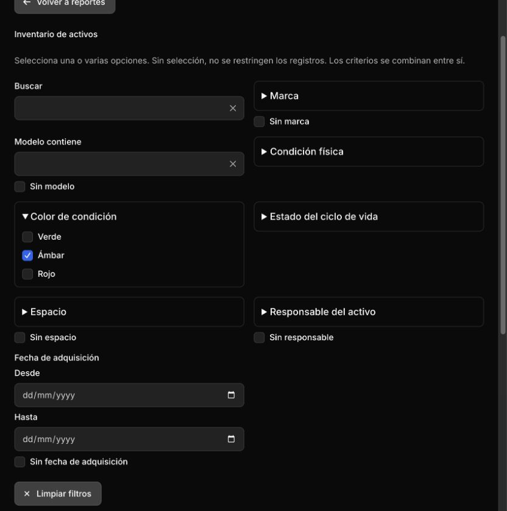
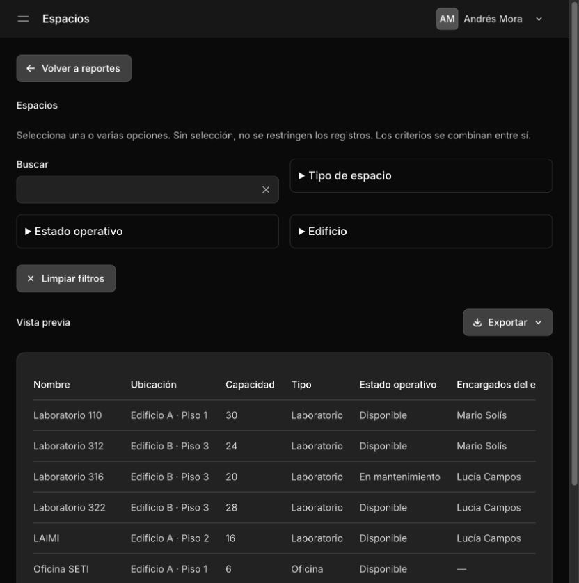

# Manuales de usuario

Guías en español para quienes usan el sistema en SETI. Cada módulo agrega aquí su manual a partir del Sprint 2
(ver la Definición de Terminado en `CONTRIBUTING.md`): qué hace cada pantalla, quién puede usarla y los pasos de
cada acción, con capturas tomadas en el teléfono y en la computadora.

| Manual | Módulo | Estado |
|---|---|---|
| `inicio-de-sesion.md` | Seguridad | Pendiente |
| `activos.md` | Activos | Pendiente |
| `espacios.md` | Espacios | Pendiente |
| `reservas.md` | Reservas | Pendiente |
| `reportes.md` | Reportes | Pendiente |
| `usuarios-y-roles.md` | Usuarios y roles | Pendiente |

## Menú de reportes (RF_60)

La cuenta de demostración `reportes@seti.test` (contraseña `password`) puede abrir **Reportes** y cambiar entre
Activos, Espacios, Auditoría y Usuarios. Cada categoría ofrece los reportes implementados que puede consultar.
Cuando no hay ninguno disponible, aparece un mensaje informativo. Los reportes planificados para sprints futuros
aparecen como **Próximamente**; los que la cuenta no puede consultar se ocultan.

## Inventario de activos (RF_63)

En **Reportes → Activos → Inventario de activos**, consulta los datos actuales, incluida la condición física y el
estado del ciclo de vida en columnas separadas. Despliega **Color de condición**, marca **Ámbar** y compara el total
con el inventario completo. Puedes combinar marca, modelo, condición, estado, espacio, responsable y fechas.
**Sin marca**, **Sin modelo**, **Sin espacio**, **Sin responsable** y **Sin fecha de adquisición** son selecciones
explícitas; dejar un filtro vacío no restringe los registros.

Usa **Limpiar filtros** para volver al inventario completo. **Exportar** ofrece PDF y Excel (XLSX), con todos los
registros coincidentes, aunque la vista previa tenga varias páginas. Un rango de fechas invertido muestra un
error y bloquea la vista previa y la exportación hasta corregirlo.

## Espacios (RF_64)

En **Reportes → Espacios → Espacios**, consulta nombre, ubicación, capacidad, tipo, estado operativo y encargados.
Combina la búsqueda con **Tipo de espacio**, **Estado operativo** y **Edificio**; varias opciones del mismo filtro
se aceptan como alternativas. **Limpiar filtros** restaura todos los espacios. **Exportar** ofrece PDF y Excel
(XLSX) con los datos actuales de todos los espacios coincidentes.

Para demostrar un resultado vacío, busca `No existe espacio`; aparece un mensaje informativo. La cuenta
`visualizador@seti.test` no tiene acceso a los reportes (contraseña de demostración `password`).

