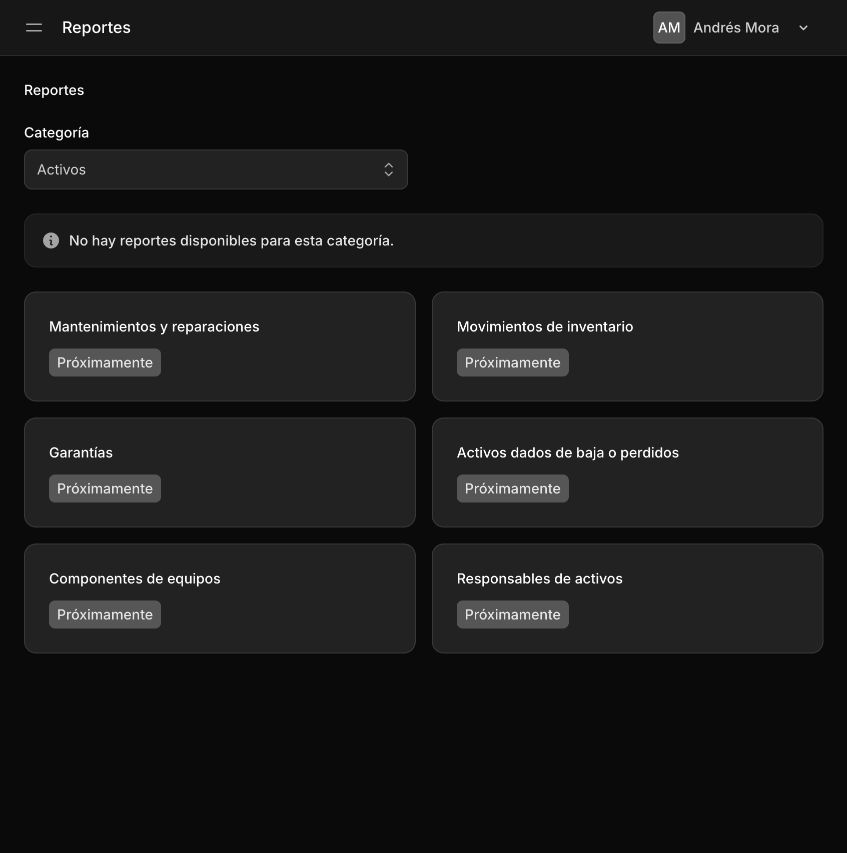
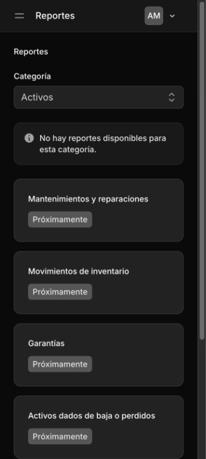

# Manuales de usuario

Guías en español para quienes usan el sistema en SETI. Cada módulo agrega aquí su manual a partir del Sprint 2
(ver la Definición de Terminado en `CONTRIBUTING.md`): qué hace cada pantalla, quién puede usarla y los pasos de
cada acción, con capturas tomadas en el teléfono y en la computadora.

| Manual | Módulo | Estado |
|---|---|---|
| `inicio-de-sesion.md` | Seguridad | Pendiente |
| `activos.md` | Activos | Pendiente |
| `espacios.md` | Espacios | Pendiente |
| `reservas.md` | Reservas | Pendiente |
| `reportes.md` | Reportes | Pendiente |
| `usuarios-y-roles.md` | Usuarios y roles | Pendiente |

## Menú de reportes (RF_60)

La cuenta de demostración `reportes@seti.test` (contraseña `password`) puede abrir **Reportes** y cambiar entre
Activos, Espacios, Auditoría y Usuarios. Cada categoría ofrece los reportes implementados que puede consultar.
Cuando no hay ninguno disponible, aparece un mensaje informativo. Los reportes planificados para sprints futuros
aparecen como **Próximamente**; los que la cuenta no puede consultar se ocultan.

## Notificaciones de reservas (RF_47, RF_48)

Cuando alguien reserva un espacio, el Superusuario y los encargados de ese espacio reciben una notificación en la
campana de la barra superior, sin recargar la página. La notificación indica el espacio, la fecha y el horario, el
motivo y quién reservó; quien hizo la reserva no recibe aviso. Al tocar una notificación se marca como leída y se abre
el detalle de la reserva; **Marcar todas como leídas** limpia el contador. Para probarlo, reserva **LAB-110** con
`reservante@seti.test` y abre la campana con `superusuario@seti.test` o `admin@seti.test` (contraseña `password`).
