# Manuales de usuario

Guías en español para quienes usan el sistema en SETI. Cada módulo agrega aquí su manual a partir del Sprint 2
(ver la Definición de Terminado en `CONTRIBUTING.md`): qué hace cada pantalla, quién puede usarla y los pasos de
cada acción, con capturas tomadas en el teléfono y en la computadora.

| Manual | Módulo | Estado |
|---|---|---|
| `inicio-de-sesion.md` | Seguridad | Pendiente |
| `activos.md` | Activos | Pendiente |
| `espacios.md` | Espacios | Pendiente |
| `reservas.md` | Reservas | Pendiente |
| `reportes.md` | Reportes | Pendiente |
| `usuarios-y-roles.md` | Usuarios y roles | Pendiente |

## Menú de reportes (RF_60)

La cuenta de demostración `reportes@seti.test` (contraseña `password`) puede abrir **Reportes** y cambiar entre
Activos, Espacios, Auditoría y Usuarios. Cada categoría ofrece los reportes implementados que puede consultar.
Cuando no hay ninguno disponible, aparece un mensaje informativo. Los reportes planificados para sprints futuros
aparecen como **Próximamente**; los que la cuenta no puede consultar se ocultan.

## Inventario de activos (RF_63)

En **Reportes → Activos → Inventario de activos**, consulta los datos actuales, incluida la condición física y el
estado del ciclo de vida en columnas separadas. Despliega **Color de condición**, marca **Ámbar** y compara el total
con el inventario completo. Puedes combinar marca, modelo, condición, estado, espacio, responsable y fechas.
**Sin marca**, **Sin modelo**, **Sin espacio**, **Sin responsable** y **Sin fecha de adquisición** son selecciones
explícitas; dejar un filtro vacío no restringe los registros.

Usa **Limpiar filtros** para volver al inventario completo. **Exportar** ofrece PDF y Excel (XLSX), con todos los
registros coincidentes, aunque la vista previa tenga varias páginas. Un rango de fechas invertido muestra un
error y bloquea la vista previa y la exportación hasta corregirlo.

## Espacios (RF_64)

En **Reportes → Espacios → Espacios**, consulta nombre, ubicación, capacidad, tipo, estado operativo y encargados.
Combina la búsqueda con **Tipo de espacio**, **Estado operativo** y **Edificio**; varias opciones del mismo filtro
se aceptan como alternativas. **Limpiar filtros** restaura todos los espacios. **Exportar** ofrece PDF y Excel
(XLSX) con los datos actuales de todos los espacios coincidentes.

Para demostrar un resultado vacío, busca `No existe espacio`; aparece un mensaje informativo. La cuenta
`visualizador@seti.test` no tiene acceso a los reportes (contraseña de demostración `password`).

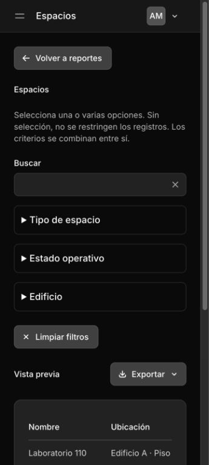

## Movimientos de activos (RF_06, RF_25)

Un **Administrador** puede registrar movimientos de los activos que están (o estuvieron por última vez) en los
espacios de los que es encargado; el **Superusuario**, de cualquier activo. Pruébalo con `admin@seti.test`
(contraseña `password`).

1. Abre un activo desde **Inventario de activos** y pulsa **Registrar movimiento**.
2. Elige el tipo: **Traslado a otro espacio**, **Salida de los espacios de SETI** (reparación externa, préstamo,
   desecho) o, si el activo está fuera, **Ingreso a un espacio**. Solo aparecen los tipos que el estado del activo
   permite: un activo perdido no se mueve hasta registrar su recuperación y uno dado de baja solo puede salir.
3. Elige el espacio destino (no aplica a una salida). La fecha y hora son opcionales: vacías, el movimiento queda con
   la hora actual; también puedes registrar uno anterior, pero no anterior al último movimiento del activo.
4. Escribe el motivo (obligatorio en una salida) y pulsa **Registrar movimiento**. Un aviso confirma el espacio al que
   se trasladó el activo y la ficha muestra su nueva ubicación.

La ficha del activo lista todos sus movimientos, del más reciente al más antiguo, con la fecha, el tipo, el origen,
el destino, quién lo registró y el motivo. Un Administrador que abre un activo de un espacio que no tiene asignado
ve un aviso de que no puede trasladarlo; las cuentas sin el permiso no ven el botón.

## Eliminar un activo (RF_02)

Eliminar sirve solo para un activo **registrado por error**. Si el activo existe y deja de usarse, no se elimina: se
da de baja. Un **Administrador** puede eliminar los activos que están (o estuvieron por última vez) en los espacios de
los que es encargado; el **Superusuario**, cualquiera. Pruébalo con `admin@seti.test` (contraseña `password`).

1. Abre el activo desde **Inventario de activos** y pulsa **Eliminar**.
2. Lee la confirmación y pulsa **Eliminar activo**. Con **Cancelar** el activo queda tal como estaba.
3. Un aviso confirma la eliminación y vuelves al inventario, donde el activo ya no aparece. Tampoco aparece en los
   reportes, pero su historial (movimientos y auditoría) se conserva y su placa queda libre para otro activo.

Si otra persona eliminó el activo mientras tenías abierta su ficha, un aviso indica que ya no existe. Las cuentas sin el
permiso, o un Administrador ante un activo de un espacio que no tiene asignado, no ven el botón.

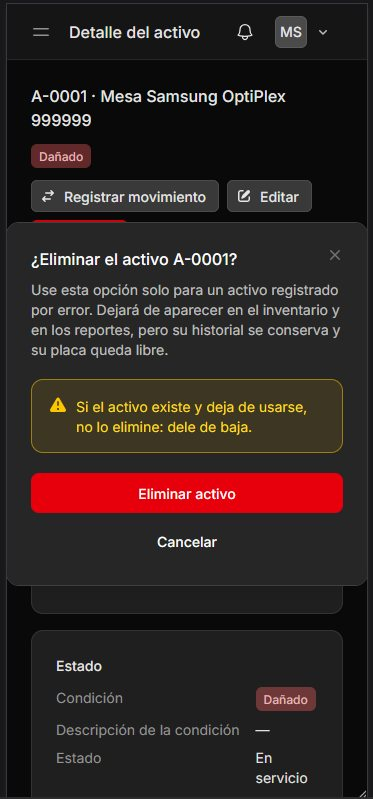

## Componentes de un activo (RF_12, RF_31)

La ficha de cada activo tiene una tarjeta **Componentes** con sus partes internas (memoria, disco, fuente de poder):
nombre, especificaciones, número de serie, cantidad y notas. Toda cuenta que puede ver el activo la consulta; si el
activo no tiene componentes, la tarjeta lo indica.

Un **Administrador** puede registrar, editar y eliminar los componentes de los activos que están (o estuvieron por
última vez) en los espacios de los que es encargado; el **Superusuario**, de cualquier activo. Pruébalo con
`admin@seti.test` (contraseña `password`).

1. Abre un activo desde **Inventario de activos** y, en **Componentes**, pulsa **Añadir componente**.
2. Escribe el nombre (obligatorio) y la cantidad (1 o más); las especificaciones, la serie y las notas son opcionales.
   Pulsa **Guardar componente**: un aviso lo confirma y aparece en la lista.
3. Para cambiarlo, pulsa el lápiz de su fila; para eliminarlo, la papelera y confirma con **Eliminar componente**.

Los componentes de un activo dado de baja se consultan, pero ya no se modifican.

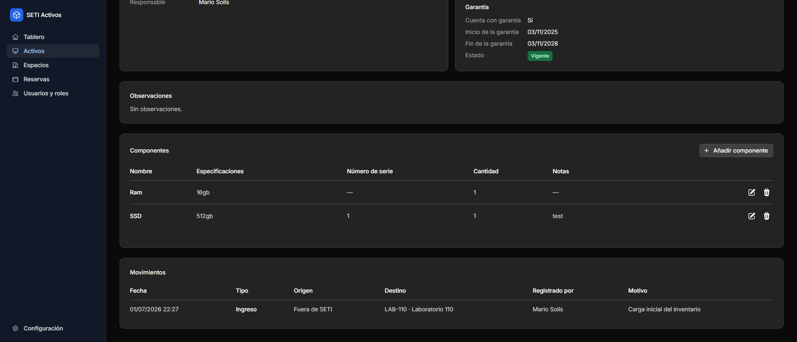

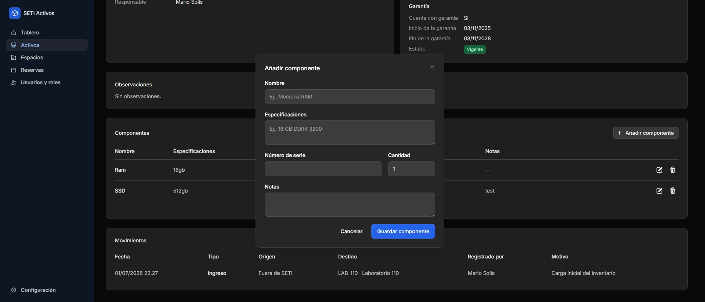

## Pérdida, recuperación y baja de un activo (RF_22, RF_28, RF_29)

La ficha de cada activo tiene una tarjeta **Eventos** con sus pérdidas, recuperaciones y su baja: fecha, tipo,
descripción y quién lo registró. Toda cuenta que puede ver el activo la consulta. Un **Administrador** registra los
eventos de los activos que están (o estuvieron por última vez) en los espacios de los que es encargado; el
**Superusuario**, los de cualquier activo. Pruébalo con `admin@seti.test` (contraseña `password`).

1. Abre un activo desde **Inventario de activos** y, en **Eventos**, pulsa **Registrar evento**.
2. Elige el tipo; solo aparecen los que el estado del activo permite:
   - **Pérdida** (activo en servicio o en mantenimiento): queda **Perdido**, deja de contarse como disponible y no se
     puede trasladar.
   - **Recuperación** (activo perdido): el activo apareció y vuelve a **En servicio**.
   - **Baja** (activo en servicio, en mantenimiento o perdido): es definitiva.
3. Indica la fecha (no puede ser futura ni anterior a la adquisición) y una descripción o el motivo de la baja, y pulsa
   **Registrar**. Un aviso lo confirma y la tarjeta **Estado** muestra la fecha de la pérdida o de la baja.

Un activo dado de baja sigue en el inventario con el estado **De baja** y conserva todo su historial, pero ya no está
disponible: no se traslada (solo admite una salida de su espacio), y sus datos, componentes y archivos ya no se
modifican. Darlo de baja no es eliminarlo: **Eliminar** queda solo para un registro hecho por error.

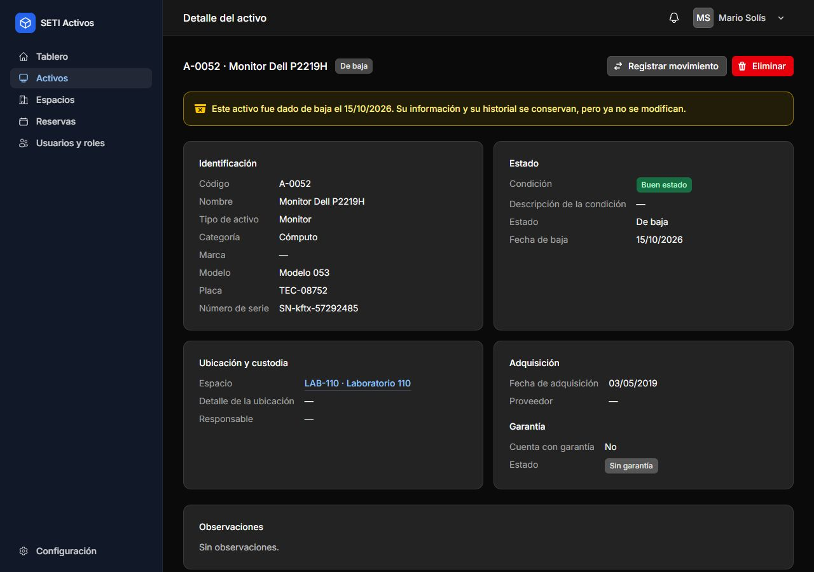
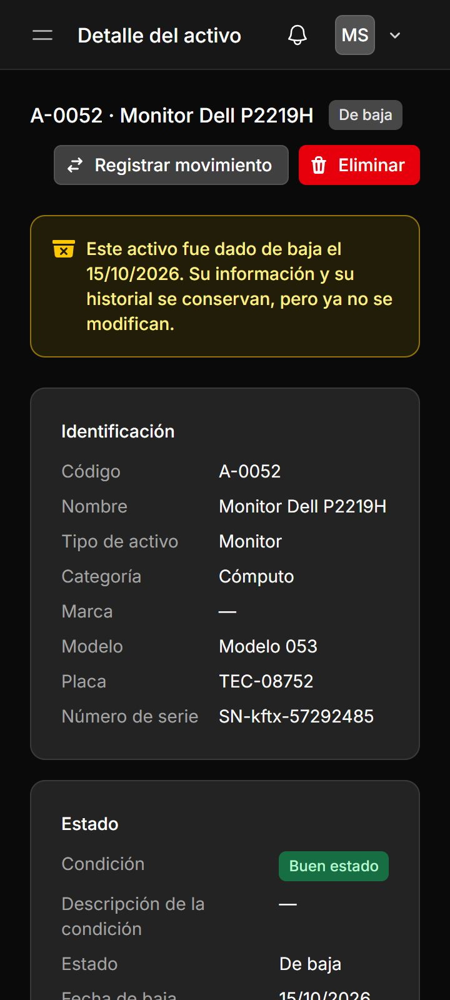
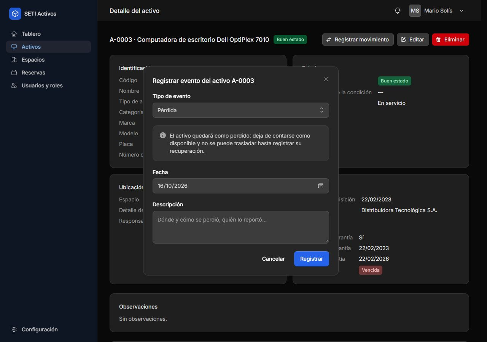
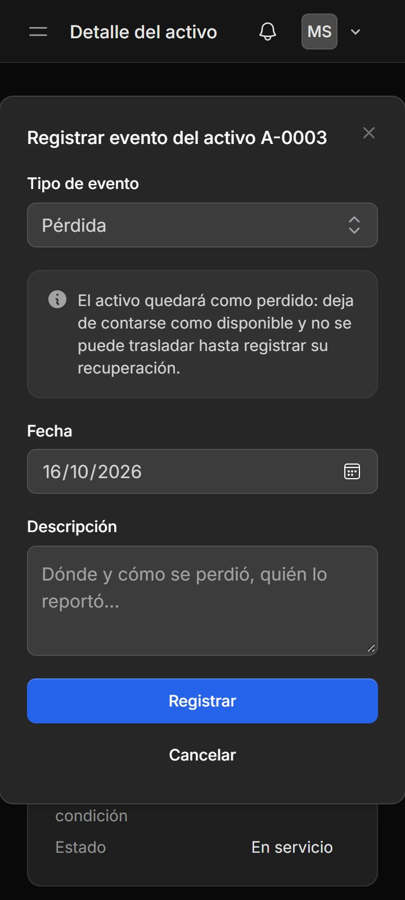

## Daño de un activo (RF_13)

En la tarjeta **Eventos** de un activo en servicio o en mantenimiento, **Registrar evento** ofrece el tipo **Daño**. Lo
registran las mismas cuentas que los demás eventos: el **Administrador** encargado del espacio del activo o el
**Superusuario**. Pruébalo con `admin@seti.test` (contraseña `password`).

1. Pulsa **Registrar evento** y deja el tipo **Daño**.
2. Indica la fecha y describe el daño. Elige la condición dañada (grupo rojo; por defecto **Dañado**): sin ella no se
   puede registrar el daño.
3. Opcionalmente, pulsa **Elegir archivos** y adjunta hasta diez fotografías (10 MB) o PDF (20 MB) como evidencia.
4. Pulsa **Registrar**. El activo queda en la condición elegida y sigue en servicio; el daño aparece en **Eventos**
   con enlaces a su evidencia, que solo se abre desde la ficha de ese activo.

Un activo perdido o dado de baja no admite daños.

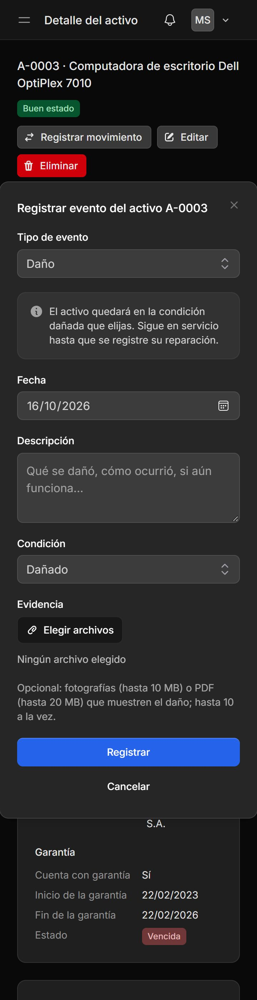
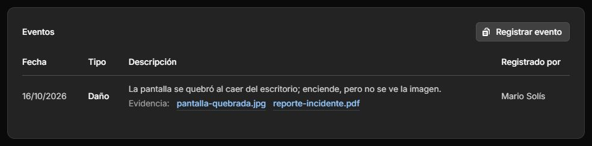

## Historial de un activo (RF_09)

En la ficha de un activo, **Historial** abre todo lo que le ha pasado, del más reciente al más antiguo. Lo consulta toda
cuenta que puede ver activos; por ejemplo, `visualizador@seti.test` (contraseña `password`). Cada entrada indica su
fecha y quién la hizo:

- **Movimiento:** ingresos, traslados y salidas, con el origen, el destino y el motivo.
- **Evento:** daños, pérdidas, recuperaciones y la baja, con su descripción.
- **Mantenimiento:** los mantenimientos correctivos y preventivos, con su descripción y quién hizo el trabajo.
- **Cambio:** el registro del activo, cada modificación de sus datos (campo, valor anterior y valor nuevo) y los
  archivos adjuntados o retirados, hechos por un Administrador o el Superusuario.

Si el activo todavía no ha recibido cambios, la página indica que su historial se encuentra vacío.

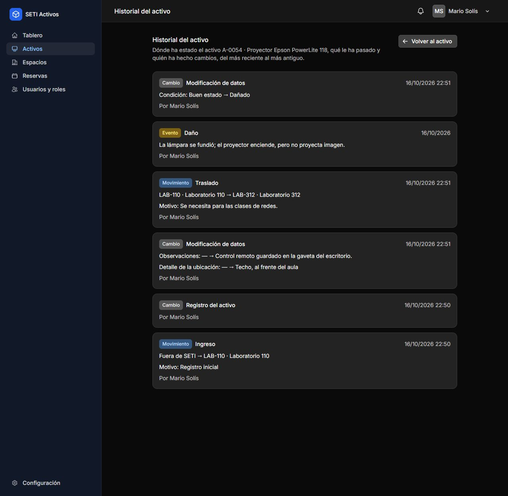
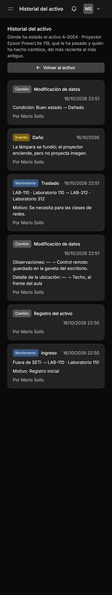

## Mantenimiento de un activo (RF_10, RF_26)

La ficha de un activo muestra la tarjeta **Mantenimientos**, con los mantenimientos ya realizados: fecha, tipo,
descripción, responsable del trabajo y quién lo registró. La consulta toda cuenta que puede ver activos. Registran
mantenimientos el **Administrador** encargado del espacio del activo y el **Superusuario**. Pruébalo con
`admin@seti.test` (contraseña `password`).

1. Pulsa **Registrar mantenimiento**.
2. Elige el tipo: **Correctivo** (se corrigió una falla o un daño) o **Preventivo** (una revisión periódica).
3. Indica la fecha en que se hizo (no puede ser futura ni anterior a la adquisición del activo), el responsable (el
   técnico o la empresa que hizo el trabajo) y una descripción.
4. Pulsa **Registrar**. El mantenimiento aparece en la tarjeta y en el **Historial** del activo; el estado del activo no
   cambia.

Un activo perdido o dado de baja no admite mantenimientos.

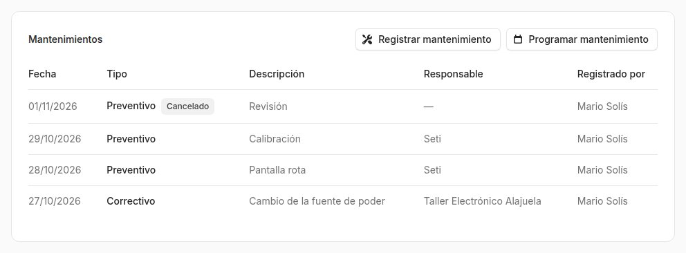
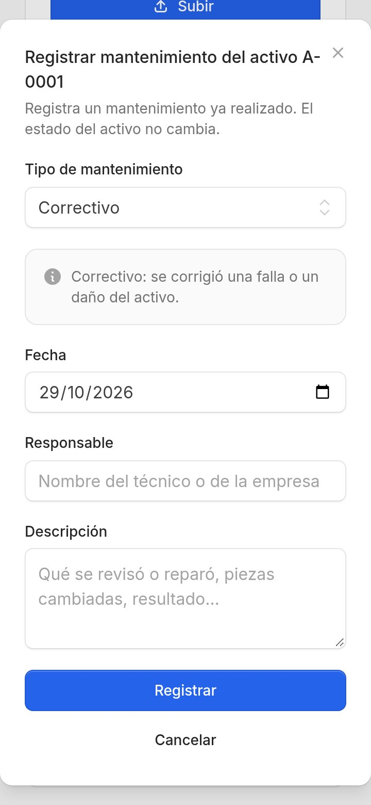

## Reparación de un activo (RF_11)

En la tarjeta **Mantenimientos** de un activo **dañado** (condición roja, por ejemplo después de registrar un daño),
el **Administrador** encargado del espacio del activo y el **Superusuario** ven **Registrar reparación**. Pruébalo con
`admin@seti.test` (contraseña `password`).

1. Pulsa **Registrar reparación**. El daño más reciente del activo viene elegido; puedes cambiarlo o elegir **Sin daño
   asociado**.
2. Indica la fecha, el responsable (técnico o empresa) y qué se reparó.
3. Elige el estado:
   - **En curso:** el activo queda **En mantenimiento** y conserva su condición dañada.
   - **Finalizada:** elige la nueva condición del activo (verde o ámbar, por defecto **Buen estado**); el activo sigue
     en servicio.
4. Pulsa **Registrar**. La reparación aparece en la tarjeta, con el daño que repara, y en el **Historial**.

Una reparación **En curso** muestra en su fila:

- **Finalizar:** pide la fecha de finalización (no anterior al inicio) y la nueva condición. El activo vuelve a estar
  **En servicio**.
- **Cancelar:** para una reparación registrada por error o que no se hará, con un motivo opcional. El activo vuelve a
  estar en servicio sin cambiar su condición, y la reparación queda como **Cancelado**.

Un activo en buen estado, perdido, dado de baja o que ya tiene una reparación en curso no ofrece **Registrar
reparación**.

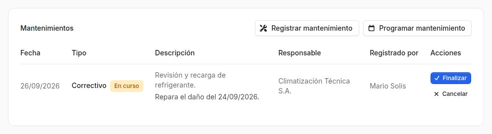
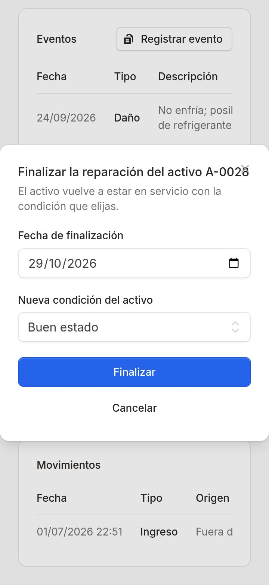

## Programar mantenimiento (RF_27)

En la tarjeta **Mantenimientos** de un activo en servicio o en mantenimiento, el **Administrador** encargado del
espacio y el **Superusuario** ven **Programar mantenimiento**. Pruébalo con `admin@seti.test` (contraseña `password`).

1. Pulsa **Programar mantenimiento**. Elige el tipo (por defecto **Preventivo**), una fecha posterior a hoy y la
   descripción o motivo.
2. Pulsa **Registrar**. El mantenimiento aparece en la tarjeta como **Programado** (o **Vencido** si su fecha pasó).
3. En su fila:
   - **Realizado:** indica cuándo se hizo, quién lo hizo y ajusta la descripción; queda como mantenimiento completado.
   - **Modificar:** cambia el tipo, la fecha (siempre posterior a hoy) o la descripción. El cambio queda auditado.
   - **Cancelar:** con un motivo opcional; queda en el historial como **Cancelado**. Se puede cancelar aunque el
     activo se haya perdido o dado de baja.

**Mantenimientos** en el menú lateral abre **Mantenimientos programados**: todos los programados de todos los
activos, del más próximo (o más vencido) al más lejano, con su activo, espacio, tipo y descripción. **Mostrar** filtra
los vencidos o los de los próximos 7 o 30 días. Lo consulta toda cuenta que puede ver mantenimientos, por ejemplo
`visualizador@seti.test`.

**Recordatorios:** cada día a las 07:00, los encargados del espacio del activo reciben en la campana un aviso cuando un
mantenimiento programado está a 3 días o menos, y otro si su fecha pasa sin registrarlo. Si el espacio no tiene
encargados, el aviso llega al Superusuario. Al tocar el aviso se abre el activo.

## Notificaciones de reservas (RF_47, RF_48)

Cuando alguien reserva un espacio, el Superusuario y los encargados de ese espacio reciben una notificación en la
campana de la barra superior, sin recargar la página. La notificación indica el espacio, la fecha y el horario, el
motivo y quién reservó; quien hizo la reserva no recibe aviso. Al tocar una notificación se marca como leída y se abre
el detalle de la reserva; **Marcar todas como leídas** limpia el contador. Para probarlo, reserva **LAB-110** con
`reservante@seti.test` y abre la campana con `superusuario@seti.test` o `admin@seti.test` (contraseña `password`).

## Eliminar una reserva (RF_50)

Quien hizo la reserva o es su responsable, el Administrador encargado del espacio y el Superusuario ven **Eliminar** en
el detalle de una reserva que todavía no ha comenzado (en el calendario, toca el día y luego el motivo de la reserva).
El sistema pide confirmar y permite anotar un motivo opcional. La reserva se cancela: el horario queda libre en el
calendario, la reserva sigue en el historial como **Cancelada** y el Superusuario y los encargados del espacio reciben
una notificación. Las reservas en curso o finalizadas no ofrecen esta opción.

## Modificar una reserva (RF_49)

Quien hizo la reserva o es su responsable, el Administrador encargado del espacio y el Superusuario ven **Modificar** en
el detalle de una reserva que todavía no ha comenzado. El formulario trae los datos actuales: se puede cambiar el
espacio, la fecha, el horario, el motivo, la cantidad de personas, el responsable y las notas, y anotar un motivo
opcional de la modificación. Como al reservar, las horas de inicio y fin se eligen de una lista con las franjas de 15
minutos del horario permitido (07:00, 07:15…), y la hora de fin solo ofrece horas posteriores al inicio. Se aplican las
mismas reglas que al reservar (horario permitido, capacidad, espacio reservable y sin choques con otra reserva); la
reserva misma no cuenta como choque. Al guardar, la reserva muestra la etiqueta **Modificada** y el motivo de la última
modificación. El Superusuario y los encargados del espacio reciben una notificación; si la reserva cambia de espacio,
los encargados del espacio que se liberó y los del espacio nuevo reciben cada uno su aviso. Las reservas en curso,
finalizadas o eliminadas no ofrecen esta opción.
