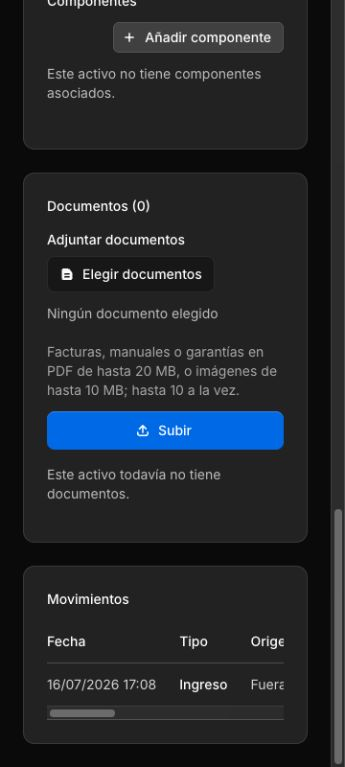

# Documentos de activos (RF_20)

En **Activos → un activo → Documentos**, abra los archivos para consultarlos. El administrador del espacio
actual o Superusuario puede elegir hasta diez PDF de hasta 20 MB o imágenes de hasta 10 MB y pulsar **Subir**.
La lista muestra nombre, tamaño, fecha y usuario. **Eliminar** pide confirmación. Adjuntar y eliminar conserva
auditoría; una transferencia de espacio revoca el acceso de modificación del administrador anterior.

