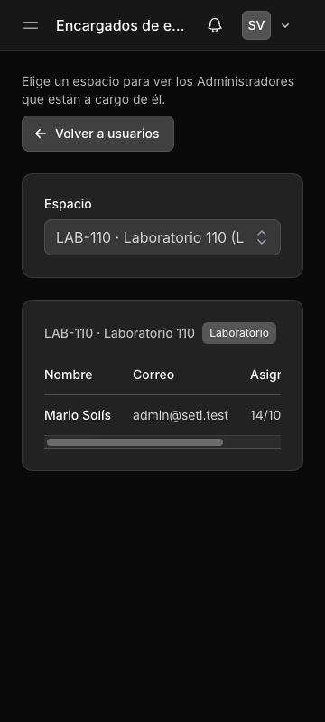

# Consultar encargados de espacios

Ingrese como **Superusuario** y abra **Usuarios y roles → Encargados**. Seleccione el espacio que desea consultar.
La lista permite elegir cualquier tipo de espacio vigente y muestra su código, nombre y tipo.

La pantalla presenta los encargados asignados al espacio, con su nombre, correo y fecha de asignación.
Los enlaces de nombre permiten abrir el usuario y el espacio. La selección se conserva en la dirección de la página
para que pueda volver a la misma consulta.

Si el espacio no tiene encargados, verá **Este espacio no tiene encargados asignados**. Si una dirección apunta
a un espacio inexistente o eliminado, la pantalla lo informa: seleccione otro espacio vigente.

Esta consulta muestra las asignaciones actuales; para asignar o retirar encargados, use las acciones correspondientes
del usuario. Las cuentas sin permiso para asignar encargados no pueden abrir esta consulta ni ven su botón.

