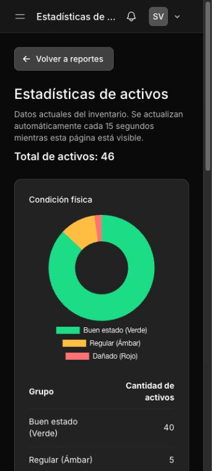

# Estadísticas de activos (RF_80)

Abra **Reportes → Estadísticas de activos**. El total y los gráficos usan los activos actuales del inventario;
los activos eliminados no se cuentan. **Condición física** (por ejemplo, Buen estado o Dañado) y
**Estado del ciclo de vida** (En servicio, En mantenimiento, Perdido o De baja) son distribuciones separadas.
Los gráficos muestran proporciones y las tablas sus cantidades, incluso cuando una cantidad es cero.

Los datos se vuelven a consultar cada 15 segundos
mientras la página está visible, y también al abrirla. Se necesita permiso para consultar reportes.

