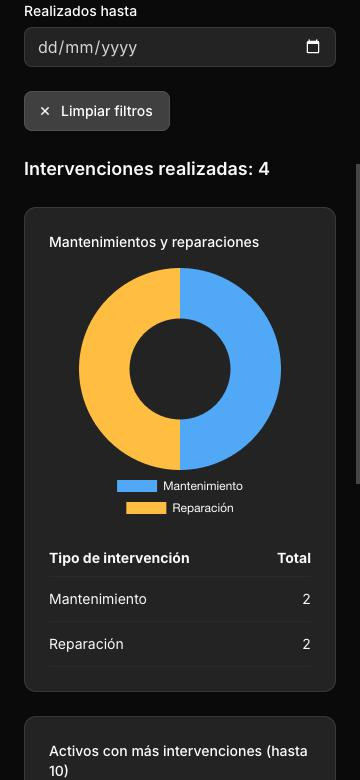

# Estadísticas de mantenimiento (RF_82)

Abra **Reportes → Estadísticas de mantenimiento** con permiso para consultar reportes. La página muestra la cantidad
de intervenciones **realizadas** (completadas) y las separa en **Mantenimiento** (preventivo) y **Reparación**
(correctivo), con un gráfico y una tabla. **Activos con más intervenciones** lista hasta 10 activos, de mayor a menor
cantidad, con sus mantenimientos, reparaciones y total. Pulse el nombre de un activo para abrir el reporte de
mantenimientos y reparaciones filtrado a ese activo y al mismo período.

Use **Realizados desde** y **Realizados hasta** para elegir el período (ambas fechas incluidas; sin fechas se cuentan
todas las intervenciones). Si la fecha final es anterior a la inicial, la página lo indica en lugar de mostrar
estadísticas. **Limpiar filtros** vuelve a contar todo. Los datos se vuelven a consultar cada 15 segundos mientras la
página está visible.

