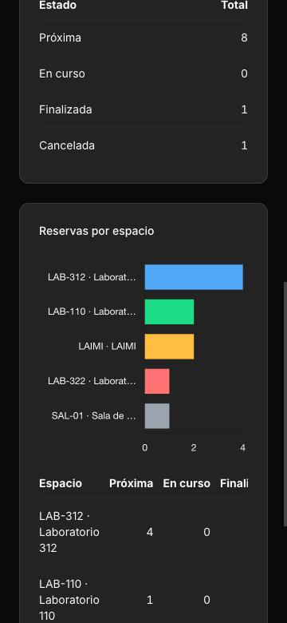

# Estadísticas de reservas (RF_83)

Abra **Reportes → Estadísticas de reservas** con permiso para consultar reportes. La página muestra cuántas reservas
hay en el período elegido, contadas por su fecha de inicio (hora de Costa Rica). **Reservas por estado** las separa en
Próxima, En curso, Finalizada y Cancelada; **Reservas por espacio** ordena los espacios de más a menos reservas y la
tabla muestra, para cada espacio, cuántas tiene en cada estado.

Elija el período con **Desde** y **Hasta** (ambas fechas incluidas; sin fechas se cuentan todas las reservas).
**Limpiar filtros** vuelve a contar todo. Los datos se vuelven a consultar cada 15 segundos mientras la página está
visible, así que una reserva nueva, modificada o cancelada se refleja sin recargar.

