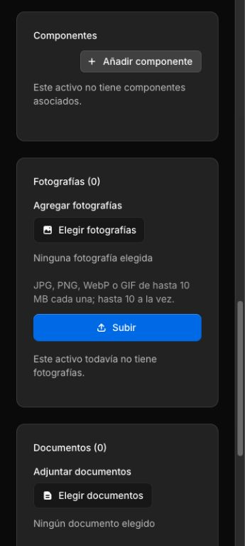

# Fotografías de activos (RF_21)

En **Activos → un activo → Fotografías**, consulte las miniaturas y abra la fotografía completa.
El administrador del espacio actual o Superusuario puede elegir hasta diez JPEG, PNG, WebP o GIF de hasta 10 MB
cada una y pulsar **Subir**. **Eliminar** muestra la imagen y pide confirmación. Las fotografías se mantienen
separadas de los documentos; cada cambio conserva auditoría y respeta el espacio actual del activo.

