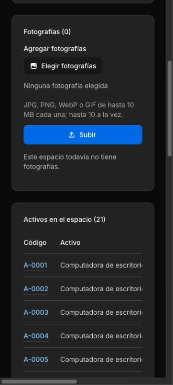

# Fotografías de espacios (RF_41)

Abra **Espacios → un espacio → Fotografías**. Cualquier usuario con permiso de consulta puede abrir una fotografía.
El administrador asignado o Superusuario puede elegir hasta diez JPEG, PNG, WebP o GIF de hasta 10 MB cada una,
pulsar **Subir** y ver su miniatura. **Eliminar** pide confirmación y conserva la auditoría del cambio.
Los archivos se sirven por rutas autorizadas; no se publican rutas de almacenamiento.

