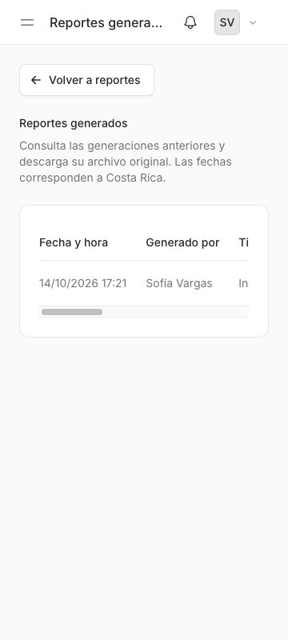

# Historial de reportes (RF_84)

Con permiso de historial, abra **Reportes → Reportes generados**. La tabla muestra primero las generaciones
más recientes: fecha y hora de Costa Rica, usuario generador, tipo, categoría, formato y cantidad de registros.
En móvil, deslice la tabla horizontalmente para consultar sus columnas. Use la paginación para consultar registros anteriores.

**Descargar original** recupera el archivo guardado el día de la generación: los cambios posteriores al inventario
no modifican su contenido. Si el archivo fue eliminado, el registro se conserva y muestra **Archivo no disponible**.
Tener permiso de exportación no concede acceso al historial de todos los usuarios.

