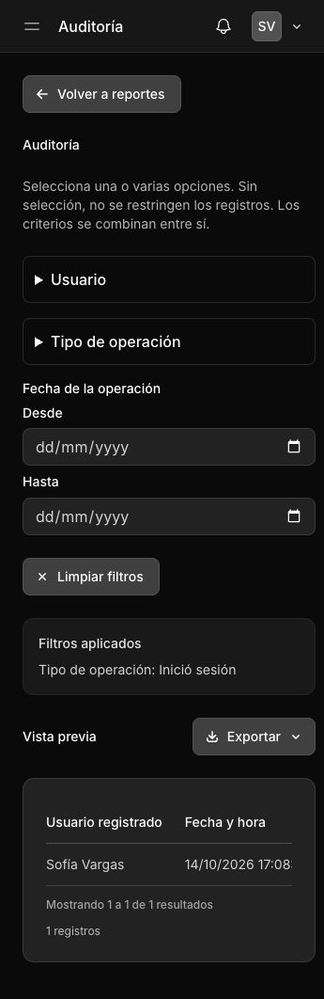

# Reporte de auditoría

Con permiso para consultar auditoría y reportes, abra **Reportes → Auditoría → Reporte de auditoría**.
El reporte muestra usuario registrado, fecha y hora, operación, elemento afectado y los valores anteriores y nuevos.
Los nombres y valores son los registrados cuando ocurrió la operación; no se sustituyen por nombres actuales.

Puede seleccionar varios usuarios u operaciones y un rango de fechas. Los días se interpretan en horario de Costa Rica
e incluyen desde las 00:00:00 del primer día hasta el final del último. Sin usuario seleccionado también aparecen
operaciones del sistema sin usuario asociado. Las cuentas desactivadas se identifican en las opciones.

**Limpiar filtros** restablece todos los registros. Una combinación sin coincidencias muestra un mensaje;
una opción o fecha inválida bloquea la consulta y la exportación hasta corregirla. Use **Exportar** para PDF o XLSX;
la generación se registra sin modificar las operaciones anteriores.

