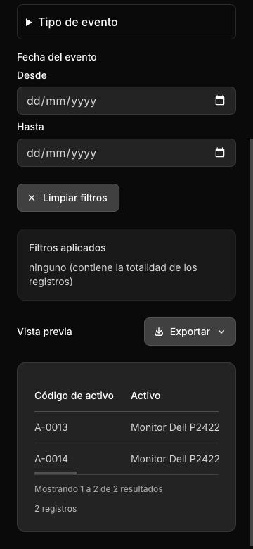

# Reporte de activos dados de baja o perdidos (RF_76)

Abra **Reportes → Activos → Activos dados de baja o perdidos** con permiso para consultar reportes. El reporte lista
cada **Baja** y cada **Pérdida** registrada, con el activo, la fecha y la descripción del evento, el usuario que lo
registró y el **estado actual del activo**. Una pérdida sigue apareciendo aunque el activo se haya recuperado
después; en ese caso su estado actual lo indica (por ejemplo, En servicio).

Filtre por **Tipo de evento** (Baja, Pérdida o ambas) y por **Fecha del evento** (ambas fechas incluidas).
**Limpiar filtros** restaura todos los eventos. Use **Exportar** para generar PDF o XLSX con los mismos filtros.

