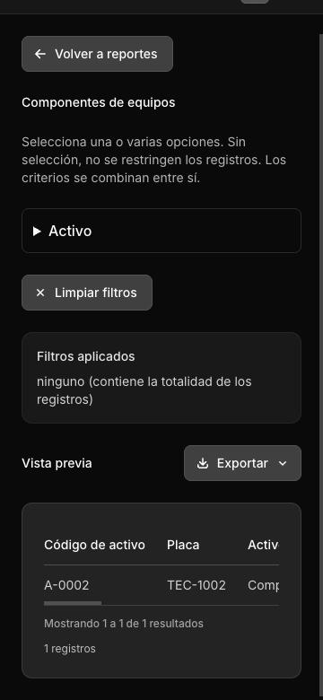

# Reporte de componentes de equipos (RF_77)

Abra **Reportes → Activos → Componentes de equipos** con permiso para consultar reportes. Cada fila muestra un
componente registrado junto al activo al que pertenece (código, placa y nombre) y su información: nombre,
especificaciones, número de serie, cantidad y notas. Los componentes se agrupan por activo. Los componentes de
activos eliminados no se incluyen.

Seleccione uno o varios activos en **Activo** para ver solo sus componentes; la lista ofrece los activos que tienen
componentes registrados. **Limpiar filtros** restaura todos los componentes. Use **Exportar** para generar PDF o
XLSX con los mismos filtros.

