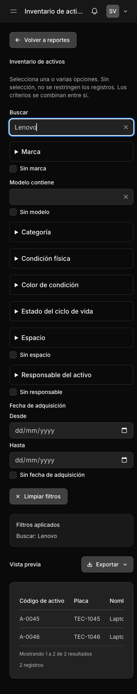

# Filtrar y exportar reportes

Con una cuenta con permiso para consultar reportes, abra **Reportes**, elija una categoría y abra un reporte disponible.
Seleccione una o varias opciones de sus filtros. Las opciones del mismo criterio se combinan como alternativas;
los criterios distintos deben cumplirse juntos. Los controles **Sin marca**, **Sin espacio** y similares incluyen
registros que carecen de esa información cuando el reporte lo permite.

La vista previa y el resumen **Filtros aplicados** se actualizan al cambiar la selección. **Limpiar filtros** vuelve
a mostrar todos los registros y restaura la primera página. Una selección inválida muestra su error y bloquea la
vista previa y la exportación hasta corregirla. Una selección válida sin coincidencias muestra el mensaje de lista vacía.

Si tiene permiso para exportar, use **Exportar → Exportar PDF** o **Exportar Excel (XLSX)**. El archivo contiene todos
los registros que cumplen los filtros, incluidos los que están en otras páginas de la vista previa. La pantalla
confirma que se generó correctamente y descarga el archivo.

El PDF muestra la fecha y hora de generación, el usuario generador y los filtros aplicados. En XLSX, la hoja **Datos**
conserva las columnas y registros; la hoja **Información** contiene la fecha y hora, el generador y los filtros.
Sin filtros, ambos formatos indican que contienen la totalidad de los registros.

