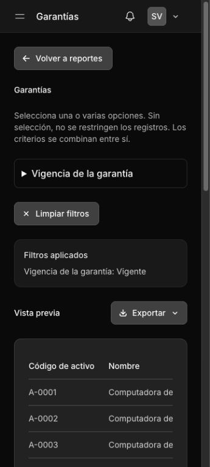

# Reporte de garantías

Abra **Reportes → Activos → Garantías** con permiso para consultar reportes. Se muestran los activos con garantía
registrada, su proveedor, inicio y finalización y su vigencia. Los activos sin garantía no forman parte de este reporte.
Si no se registró un proveedor, el reporte lo indica.

Seleccione **Vigente**, **Vencida** o ambas opciones en **Vigencia de la garantía**. Una garantía es vigente hasta
su fecha de finalización inclusive; el sistema usa la fecha de Costa Rica. **Limpiar filtros** restaura todas las garantías.
Los activos eliminados dejan de aparecer y las garantías reflejan los datos actuales del inventario.

Use **Exportar** para generar PDF o XLSX. El archivo conserva la selección y muestra su fecha, generador y filtros;
la pantalla confirma su generación.

