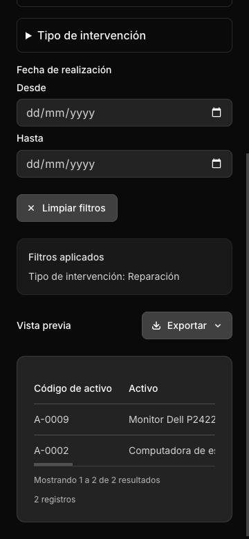

# Reporte de mantenimientos y reparaciones (RF_66)

Abra **Reportes → Activos → Mantenimientos y reparaciones** con permiso para consultar reportes. El reporte muestra
los mantenimientos y reparaciones **realizados** (completados): el código y nombre del activo, la fecha de
realización, el tipo de intervención, la descripción, quién la realizó y el usuario que la registró. Las
intervenciones programadas, en curso o canceladas no aparecen. Los registros más recientes se muestran primero.

El **tipo de intervención** distingue **Mantenimiento** (preventivo) de **Reparación** (correctivo). Filtre por
**Activo**, por **Tipo de intervención** y por **Fecha de realización** (desde y hasta, ambas fechas incluidas).
**Limpiar filtros** restaura todos los registros.

Use **Exportar** para generar PDF o XLSX con los mismos filtros; el archivo indica su fecha de generación, quién lo
generó y los filtros aplicados.

