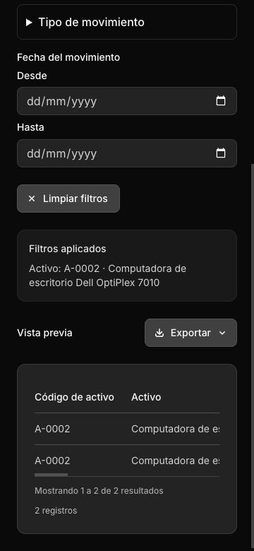

# Reporte de movimientos de inventario (RF_67)

Abra **Reportes → Activos → Movimientos de inventario** con permiso para consultar reportes. Cada fila muestra el
activo, la fecha y hora del movimiento (hora de Costa Rica), su tipo (**Ingreso**, **Traslado** o **Salida**), los
espacios de origen y destino, el usuario que lo realizó y el motivo.

Las filas se agrupan por activo y, dentro de cada activo, van en orden cronológico: así se lee el historial completo
de movimientos de cada uno. Para revisar un solo activo, selecciónelo en **Activo**. También puede filtrar por
**Tipo de movimiento** y por **Fecha del movimiento** (días completos de Costa Rica, ambas fechas incluidas).
**Limpiar filtros** restaura todos los movimientos.

Use **Exportar** para generar PDF o XLSX con los mismos filtros.

