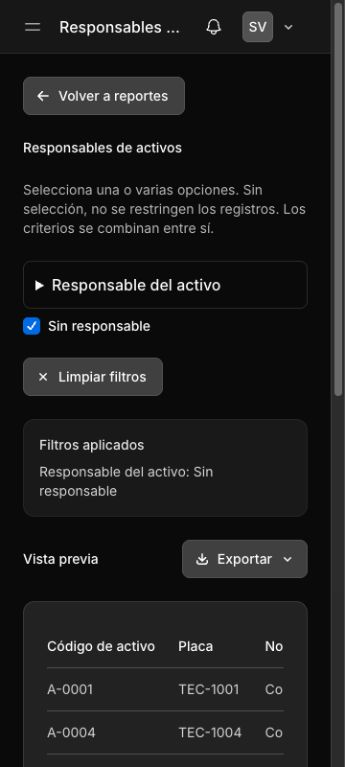

# Reporte de responsables (RF_78)

En **Reportes → Activos → Responsables**, revise el activo, su responsable actual, correo y espacio.
Seleccione uno o varios responsables; las cuentas desactivadas conservan sus asignaciones históricas.
Marque **Sin responsable** para encontrar activos pendientes de asignación. Si también selecciona usuarios,
se incluyen ambos grupos. **Limpiar filtros** vuelve a todos los activos.

La vista previa y los archivos PDF/XLSX usan la misma selección; cada exportación conserva filtros y auditoría.
Se necesita permiso para consultar y exportar reportes.

