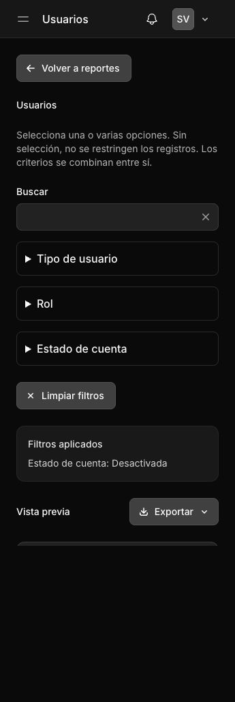

# Reporte de usuarios

Abra **Reportes → Usuarios → Usuarios** con una cuenta que tenga permiso para consultar reportes.
La tabla muestra nombre, correo, roles, estado de cuenta e invitación pendiente. Incluye cuentas activas y desactivadas,
y refleja los datos actuales, no una copia anterior del directorio.

Seleccione uno o varios roles y estados de cuenta; ambos criterios se cumplen juntos. También puede buscar o elegir
un tipo de usuario, con el mismo significado que los filtros de **Usuarios y roles**. Quienes tienen Superusuario
quedan fuera de los tipos Administradores y Usuarios normales aunque tengan otros roles; sin un tipo seleccionado
siguen apareciendo y se pueden consultar por rol.

**Limpiar filtros** restaura todos los usuarios. Los filtros inválidos muestran un error; una combinación válida sin
coincidencias muestra el mensaje de lista vacía. **Exportar** genera PDF o XLSX con los mismos filtros, fecha y usuario
generador, y confirma la generación.

