# Reservas

El módulo de Reservas permite consultar los espacios de SETI, ver si un espacio está libre, reservarlo y dar
seguimiento a cada reserva. Qué puede hacer cada persona depende de su rol:

| Rol | Qué puede hacer |
|---|---|
| **Reservante** | Consultar los espacios y el calendario, reservar, y modificar o cancelar sus propias reservas. |
| **Administrador** | Lo mismo, y además modificar o cancelar las reservas de los espacios que tiene a cargo. Recibe un aviso cuando alguien reserva uno de sus espacios. |
| **Superusuario** | Todo lo anterior en cualquier espacio. Recibe un aviso de cada reserva. |
| **Visualizador** y **Reportes** | Consultar los espacios, el calendario y el detalle de las reservas, sin reservar. |

Para probarlo en el ambiente de desarrollo, ingresa con `reservante@seti.test` (contraseña `password`). El historial
de reservas y la ocupación de espacios tienen sus propios manuales: [Historial de reservas](reservas-historial.md) y
[Ocupación de espacios por período](reservas-ocupacion.md).

## Espacios (RF_53, RF_54)

**Espacios**, en el menú lateral, muestra todos los espacios registrados. Cada fila indica el nombre y el código del
espacio, su ubicación (edificio y piso), la capacidad, el tipo y el estado (**Disponible**, **En mantenimiento** o
**Inhabilitado**). La etiqueta **Ocupado ahora** aparece cuando hay una reserva en curso en ese momento. El nombre abre
la página del espacio.

Para encontrar un espacio:

1. Marca una o varias opciones en **Tipo de espacio**, **Estado** o **Edificio**. Varias opciones de un mismo grupo
   se suman (por ejemplo, **Laboratorio** y **Sala**); grupos distintos se combinan (por ejemplo, **Laboratorio** que
   esté **Disponible**).
2. La lista y el total ("5 espacios") se actualizan al marcar cada opción, y **Filtros activos** resume lo elegido.
3. **Limpiar filtros** vuelve a mostrar todos los espacios.

Si ningún espacio cumple los criterios, la lista dice "No se encontraron espacios con los criterios aplicados.".

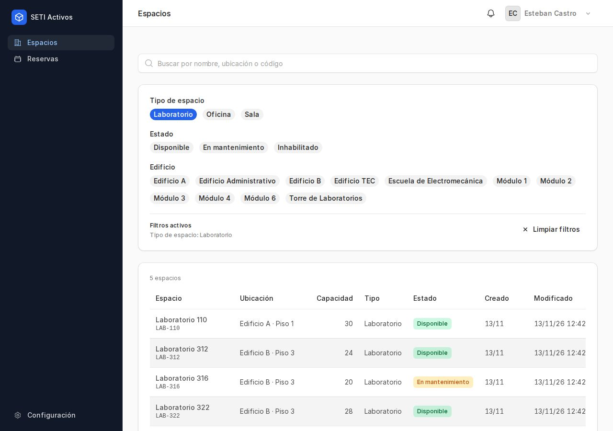
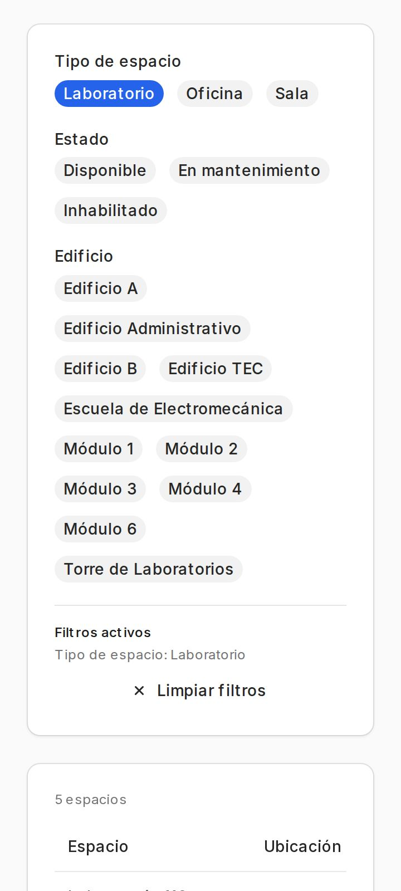

## Disponibilidad de un espacio (RF_55)

La página de cada espacio tiene la tarjeta **Disponibilidad**, para saber si el espacio está libre en un horario antes
de reservarlo.

1. Abre el espacio desde **Espacios**.
2. En **Disponibilidad**, elige la **Fecha**, la **Hora de inicio** y la **Hora de fin**.
3. Pulsa **Consultar disponibilidad**.
   - **Disponible:** el espacio está libre en ese horario. Si tu rol puede reservar, **Reservar este horario** abre
     **Nueva reserva** con el espacio, la fecha y las horas ya elegidas.
   - **No disponible:** debajo aparecen las reservas que ocupan el espacio en ese horario, con su horario, motivo y
     responsable.

La hora de fin debe ser posterior a la de inicio; si no, aparece "La hora de fin debe ser posterior a la hora de
inicio.". Un espacio que no se puede reservar (una oficina, o un espacio **En mantenimiento** o **Inhabilitado**)
muestra en la tarjeta el aviso "Este espacio no se puede reservar por su tipo o su estado actual." y no ofrece
**Reservar este horario**.

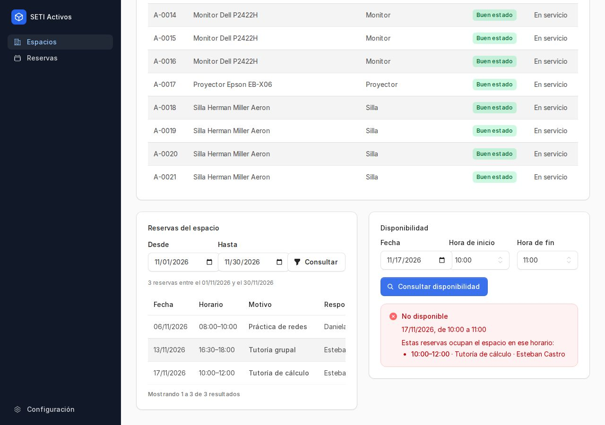
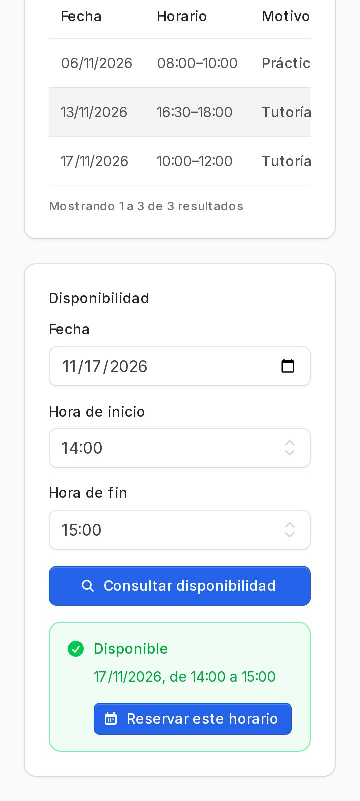

## Reservas de un espacio (RF_57)

En la página de un espacio, la tarjeta **Reservas del espacio** lista sus reservas de un período: fecha, horario,
motivo, responsable, cantidad de personas y estado. Al abrirla muestra el mes actual.

1. Cambia **Desde** y **Hasta** para elegir otro período.
2. Pulsa **Consultar**. Arriba de la tabla se indica cuántas reservas hay en el período.
3. El motivo de cada reserva abre su detalle.

Si el espacio no tiene reservas en el período, la tarjeta dice "El espacio no tiene reservas en ese período."; una
fecha final anterior a la inicial muestra un aviso para corregirla.

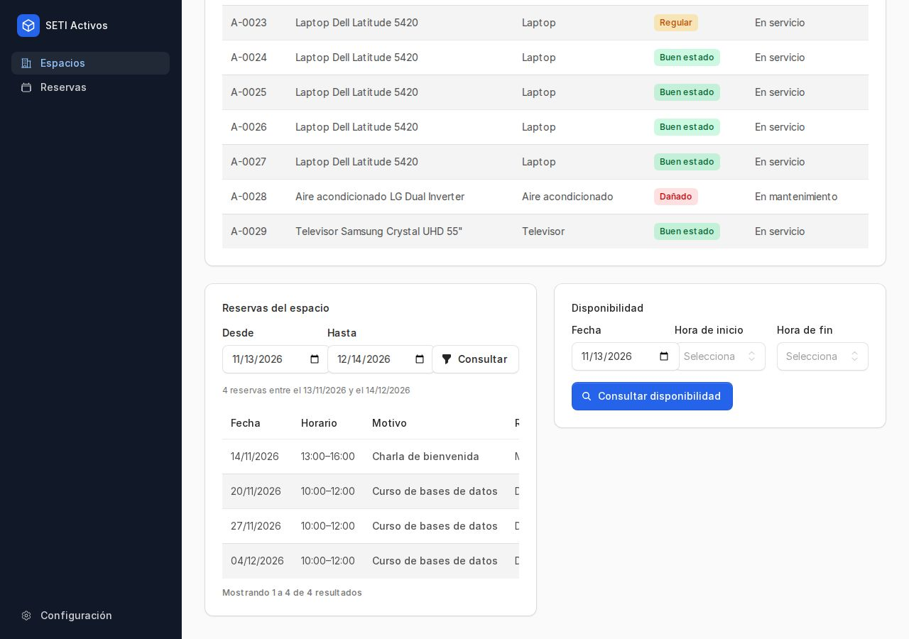
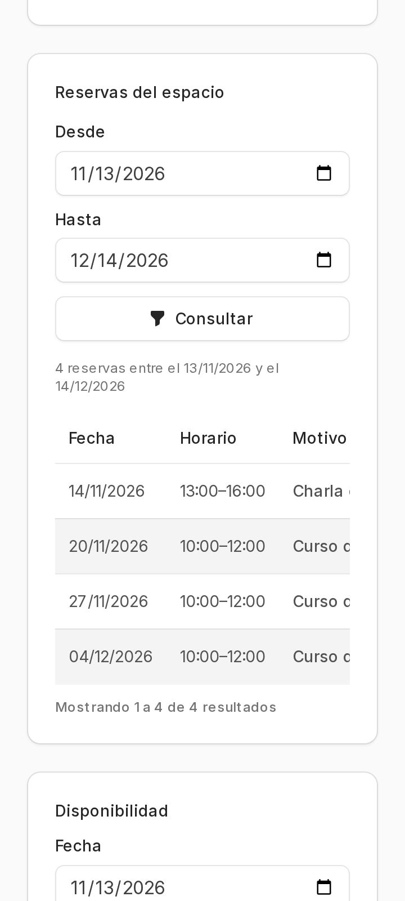

## Reservar un espacio (RF_46)

Reservan el **Reservante**, el **Administrador** y el **Superusuario**.

1. En **Reservas**, pulsa **Reservar espacio** (o **Reservar este horario** desde la disponibilidad de un espacio).
2. Elige el **Espacio**. Solo aparecen los que se pueden reservar: laboratorios y salas en estado **Disponible**. Debajo
   se muestran su ubicación y su capacidad.
3. Elige la **Fecha**, la **Hora de inicio** y la **Hora de fin**. Las horas vienen en franjas de 15 minutos dentro
   del horario permitido, y la hora de fin solo ofrece horas posteriores al inicio.
4. Escribe el **Motivo** y la **Cantidad de personas**. El **Responsable** eres tú; puedes cambiarlo por otra persona
   activa del sistema. Las **Notas** son opcionales.
5. Pulsa **Reservar**. Aparece el aviso "Se reservó …" y se abre el detalle de la reserva. El Superusuario y los
   encargados del espacio reciben una notificación.

El sistema revisa la reserva antes de guardarla y explica qué corregir:

- **Choque de horario:** "El espacio ya está reservado en ese horario. Revisa las reservas del espacio o el calendario y
  elige otro horario.". Dos reservas del mismo espacio nunca se traslapan, aunque se hagan al mismo tiempo.
- **Capacidad:** "La cantidad de personas supera la capacidad del espacio (…)".
- **Horario permitido:** se reserva de lunes a sábado, de 07:00 a 22:00 (hora de Costa Rica).
- **Fecha pasada:** "La reserva debe comenzar después de este momento.".

**Cancelar** vuelve a **Reservas** sin guardar.

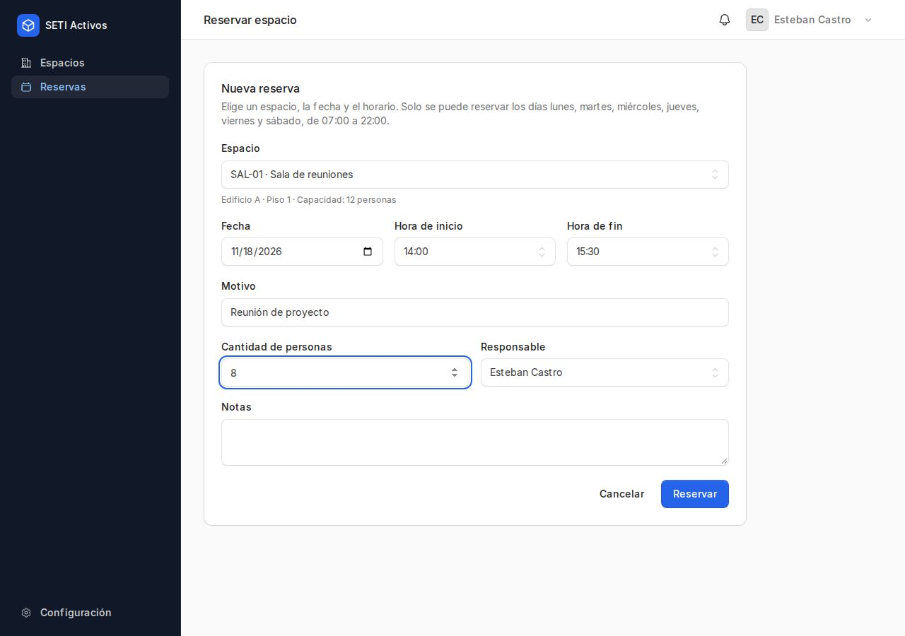
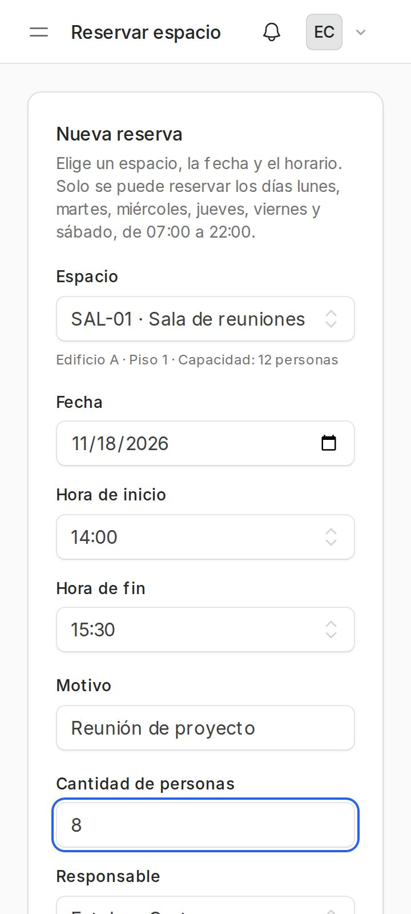

## Calendario y detalle de una reserva (RF_51)

**Reservas** abre el calendario del mes. Los días con reservas tienen un punto naranja (**Con reservas**; en la
computadora también la cantidad) y los libres, uno verde (**Libre**). **Mes anterior** y **Mes siguiente** cambian de
mes.

1. Toca un día. Debajo del calendario aparecen sus reservas: horario, espacio, motivo y "Reservado para …". Si el día
   no tiene reservas, dice "No hay reservas este día: todos los espacios están libres.".
2. Toca el motivo de una reserva para abrir su detalle (también se abre desde el historial o desde las reservas de un
   espacio).

El detalle muestra el espacio, la fecha, el horario, el motivo, la cantidad de personas, el responsable, quién hizo la
reserva, las notas y el **Estado actual**: **Próxima**, **En curso**, **Finalizada** o **Cancelada**, con la etiqueta
**Modificada** si cambió después de hacerse. Quien puede cambiar la reserva ve además **Modificar** y **Cancelar**,
mientras la reserva no haya comenzado.

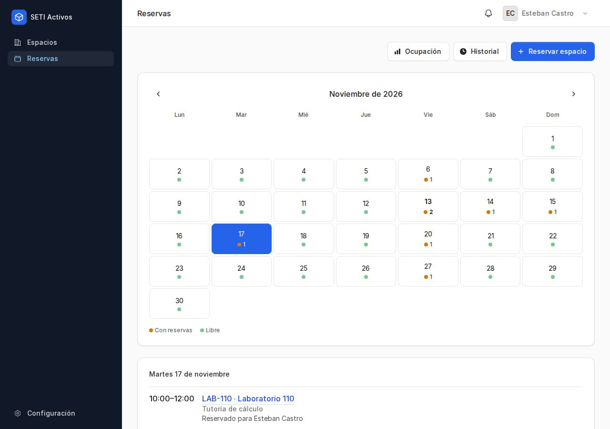
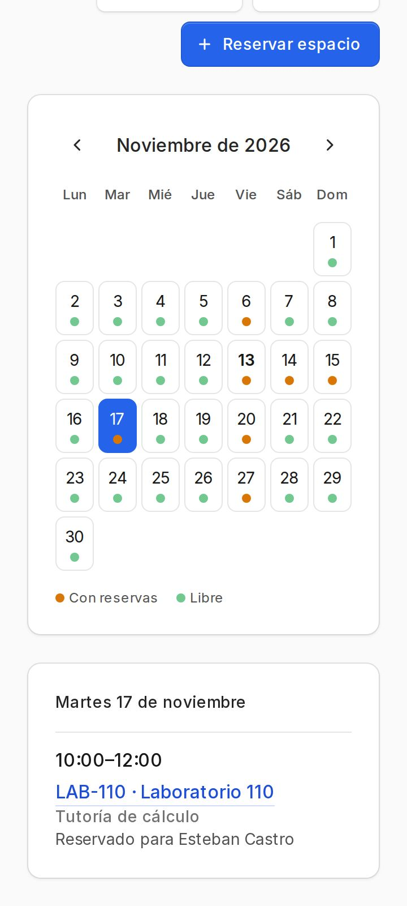
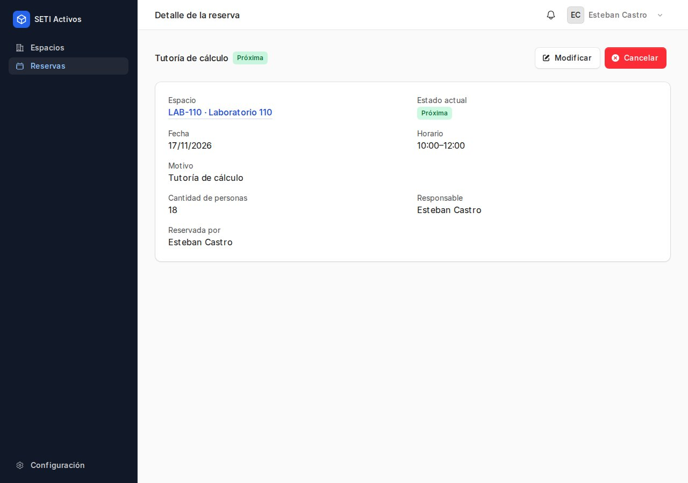
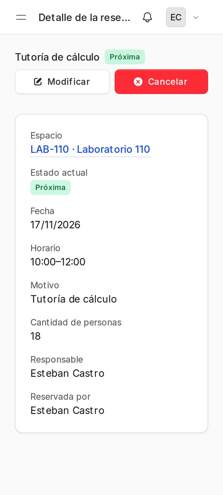

## Modificar una reserva (RF_49)

Quien hizo la reserva o es su responsable, el Administrador encargado del espacio y el Superusuario ven **Modificar** en
el detalle de una reserva que todavía no ha comenzado. El formulario trae los datos actuales: se puede cambiar el
espacio, la fecha, el horario, el motivo, la cantidad de personas, el responsable y las notas, y anotar un motivo
opcional de la modificación. Como al reservar, las horas de inicio y fin se eligen de una lista con las franjas de 15
minutos del horario permitido (07:00, 07:15…), y la hora de fin solo ofrece horas posteriores al inicio. Se aplican las
mismas reglas que al reservar (horario permitido, capacidad, espacio reservable y sin choques con otra reserva); la
reserva misma no cuenta como choque. Al pulsar **Guardar cambios**, la reserva muestra la etiqueta **Modificada** y el
motivo de la última modificación; si no cambiaste nada, el sistema lo avisa. El Superusuario y los encargados del
espacio reciben una notificación; si la reserva cambia de espacio, los encargados del espacio que se liberó y los del
espacio nuevo reciben cada uno su aviso. Las reservas en curso, finalizadas o canceladas no ofrecen esta opción.

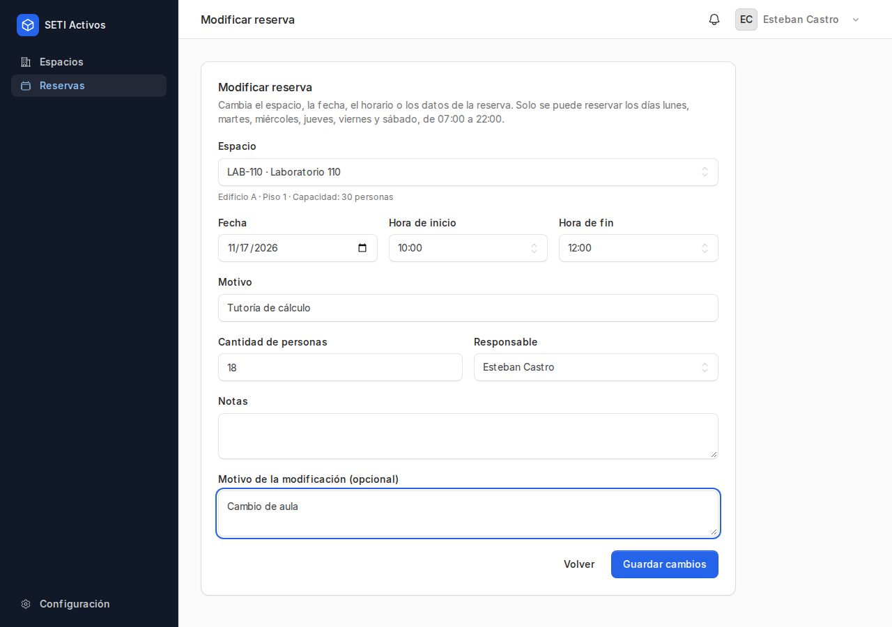
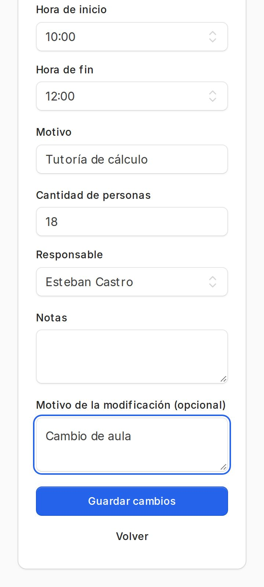

## Cancelar una reserva (RF_50)

Quien hizo la reserva o es su responsable, el Administrador encargado del espacio y el Superusuario ven **Cancelar** en
el detalle de una reserva que todavía no ha comenzado (en el calendario, toca el día y luego el motivo de la reserva).
El sistema pide confirmar en **¿Cancelar esta reserva?** y permite anotar un motivo opcional; **Volver** cierra la
confirmación sin cambiar nada. Con **Cancelar reserva**, el horario queda libre en el calendario, la reserva sigue en el
historial como **Cancelada** y el Superusuario y los encargados del espacio reciben una notificación. Las reservas en
curso o finalizadas no ofrecen esta opción.

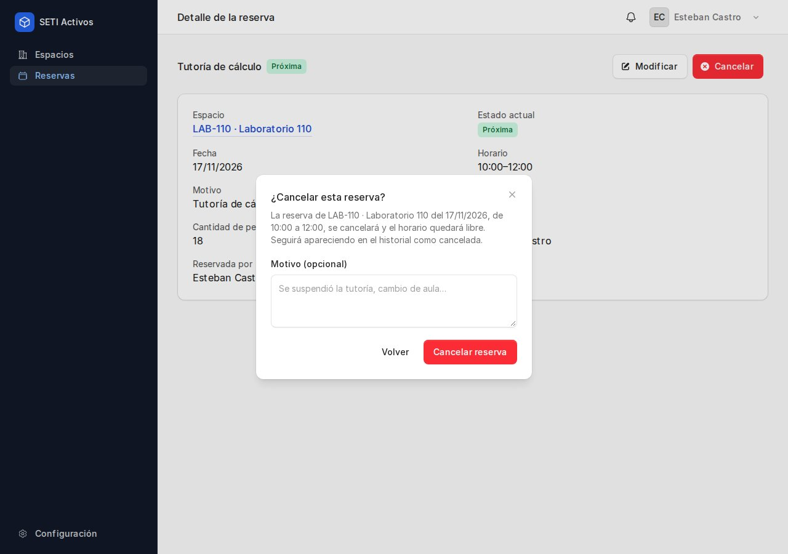
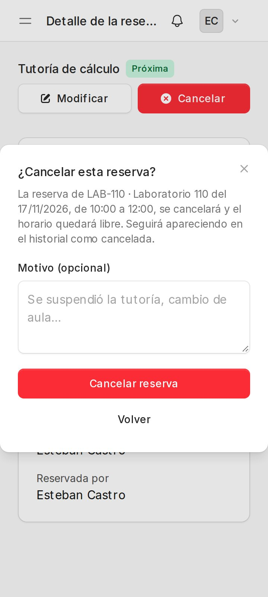

## Notificaciones de reservas (RF_47, RF_48)

Cuando alguien reserva un espacio, el Superusuario y los encargados de ese espacio reciben una notificación en la
campana de la barra superior, sin recargar la página. La notificación indica el espacio, la fecha y el horario, el
motivo y quién reservó; quien hizo la reserva no recibe aviso. Al tocar una notificación se marca como leída y se abre
el detalle de la reserva; **Marcar todas como leídas** limpia el contador. Para probarlo, reserva **LAB-110** con
`reservante@seti.test` y abre la campana con `superusuario@seti.test` o `admin@seti.test` (contraseña `password`).

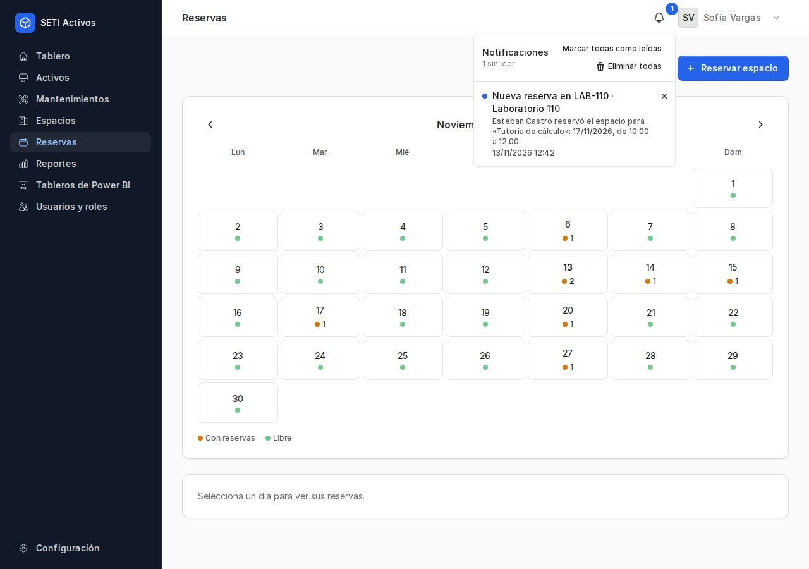
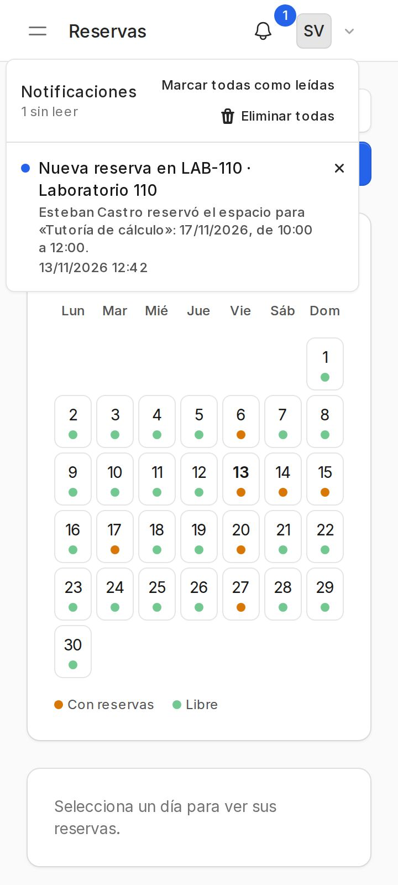
