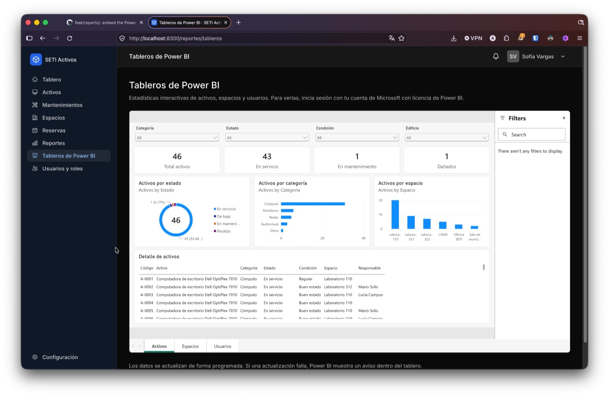
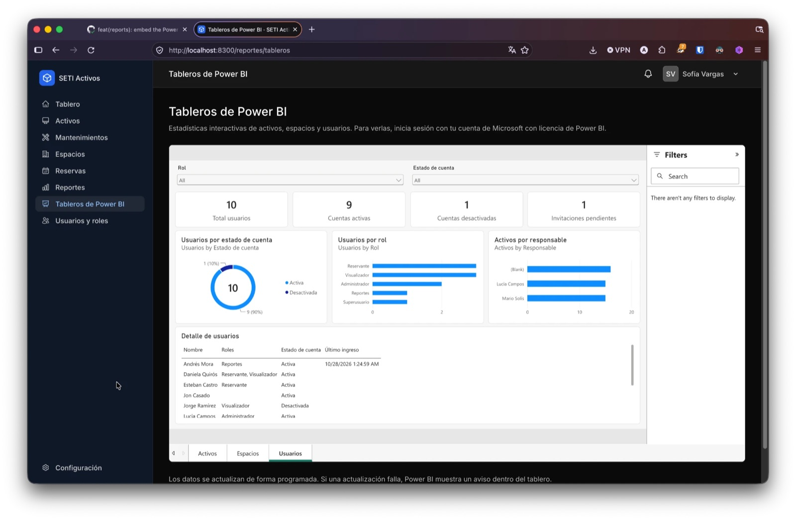

# Tableros de Power BI (RF_61)

**Tableros de Power BI**, en el menú lateral, muestra dentro del sistema estadísticas interactivas de activos, espacios
y usuarios. Solo aparece para las cuentas con el permiso `dashboards.powerbi`: el Superusuario lo tiene y puede darlo a
otras personas mediante un rol.

Para ver los tableros hace falta, además, una cuenta de Microsoft con licencia de Power BI y acceso al reporte. La
primera vez, el tablero pide iniciar sesión con esa cuenta y, si el navegador lo solicita, permitir la ventana
emergente de inicio de sesión.

Cada tablero tiene tres páginas, **Activos**, **Espacios** y **Usuarios**, que se eligen en la parte inferior:

- Usa las listas de la parte superior para filtrar la página.
- Toca una parte de un gráfico para filtrar o resaltar los demás elementos de la página.
- Pasa el cursor sobre un gráfico para ver el detalle de ese dato.

Los datos se actualizan de forma programada, no en el momento. Si una actualización falla, Power BI muestra un aviso
dentro del tablero.

## Si el tablero sigue pidiendo iniciar sesión

Si ya iniciaste sesión y el tablero lo sigue pidiendo, recarga la página. Si continúa, lo más probable es que tu
navegador esté bloqueando las cookies de terceros que Power BI necesita dentro del sistema. Tienes dos opciones:

- Usa el enlace **Abrir en Power BI**, debajo del tablero, para verlo en su propia pestaña.
- Permite esas cookies en tu navegador:
  - **Safari:** en **Ajustes > Privacidad**, desactiva la prevención de seguimiento entre sitios
    (*Prevent cross-site tracking*). Este ajuste se aplica a todos los sitios, no solo a Power BI.
  - **Firefox:** en **Ajustes > Privacidad y seguridad > Cookies y datos del sitio > Administrar excepciones**, agrega
    `app.powerbi.com`.
  - **Edge y Chrome:** no bloquees las cookies de terceros, o agrega `app.powerbi.com` a los sitios que pueden usarlas.

Si la ventana de inicio de sesión queda en negro o no carga, revisa las extensiones del navegador: las que limpian o
modifican direcciones web, como ClearURLs, pueden interrumpir el inicio de sesión. Desactívalas para Power BI o prueba
con otro navegador.

## Si los tableros no están configurados

Si la página indica que los tableros no están configurados, comunícate con el Superusuario del sistema.
