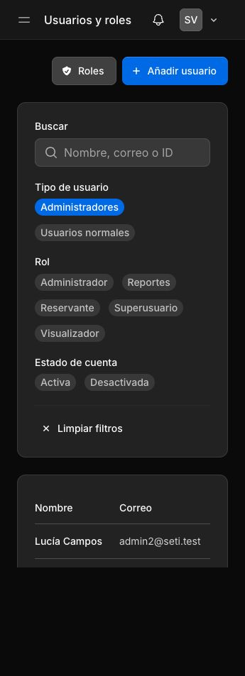

# Filtrar usuarios

Con una cuenta con permiso para consultar usuarios, abra **Usuarios y roles**. Puede buscar por nombre,
correo o identificador y seleccionar una o más opciones en **Tipo de usuario**, **Rol** y **Estado de cuenta**.

- **Administradores** muestra quienes tienen Administrador y no tienen Superusuario.
- **Usuarios normales** muestra quienes no tienen Administrador ni Superusuario.
- Superusuario queda fuera de ambos tipos, aunque tenga otros roles. Para consultarlo, deje el tipo sin
  seleccionar y use el filtro de rol si lo necesita.
- Seleccionar varias opciones del mismo criterio acepta cualquiera de ellas. Los criterios distintos se combinan:
  por ejemplo, Administradores con estado de cuenta activo y cuyo nombre coincida con la búsqueda.

Los resultados se actualizan al cambiar los controles. **Limpiar filtros** elimina las selecciones y la búsqueda
y vuelve a mostrar todos los usuarios disponibles. Si no hay usuarios del tipo seleccionado, la pantalla lo indica;
si hay usuarios de ese tipo pero los otros criterios no coinciden, indica que no se encontraron resultados.

Los filtros también se conservan en la dirección de la página. Si una dirección contiene opciones inválidas,
la pantalla muestra el error; **Limpiar filtros** permite recuperar la lista.

