# Usuarios y roles

El módulo de Usuarios y roles reúne a las personas que usan el sistema: quién tiene cuenta, con qué roles, de qué
espacios está a cargo cada Administrador y qué ha hecho cada persona. Qué puede hacer cada quien depende de su rol:

| Rol | Qué puede hacer en este módulo |
|---|---|
| **Superusuario** | Todo: registrar y editar usuarios, asignar, cambiar y retirar roles, asignar y retirar espacios a cargo, desactivar y reactivar cuentas, y consultar los roles, los encargados de espacios y la actividad de cada usuario. |
| **Administrador** | Consultar el listado de usuarios y la ficha de cada uno, sin modificar nada. |
| **Reportes** | Consultar la actividad de usuarios. |
| **Visualizador** y **Reservante** | No ven el módulo. |

Cada persona puede tener varios roles; sus permisos son la suma de los permisos de sus roles. Para probarlo en el
ambiente de desarrollo, ingresa con `superusuario@seti.test` (contraseña `password`). Los filtros del listado y la
consulta de encargados tienen sus propios manuales: [Filtrar usuarios](usuarios-filtros.md) y
[Consultar encargados de espacios](encargados-espacios.md). Restablecer la autenticación en dos pasos de una persona
se explica en el [índice de manuales](README.md#restablecer-la-autenticación-en-dos-pasos-de-una-persona-rf_00_1).

## Listado de usuarios (RF_90, RF_92, RF_95, RF_101)

**Usuarios y roles**, en el menú lateral, lista a todas las personas registradas con su nombre, correo, roles y
estado de la cuenta: **Activa** o **Desactivada**. Quien todavía no aceptó su invitación lleva además la insignia
**Invitación pendiente**. El nombre abre la ficha de la persona.

1. Escribe en **Buscar** parte del nombre, del correo o el ID. No importan las mayúsculas ni las tildes: "lucia"
   encuentra a "Lucía".
2. Marca una o varias opciones en **Tipo de usuario**, **Rol** o **Estado de cuenta**. Por ejemplo, **Desactivada**
   muestra solo las cuentas desactivadas.
3. La lista se actualiza al escribir o marcar cada opción y abajo indica cuántos resultados hay.
4. **Limpiar filtros** vuelve a mostrar a todas las personas.

La lista muestra 15 personas por página. La búsqueda y los filtros quedan en la dirección de la página, así que puedes
guardarla o compartirla para repetir la misma consulta.

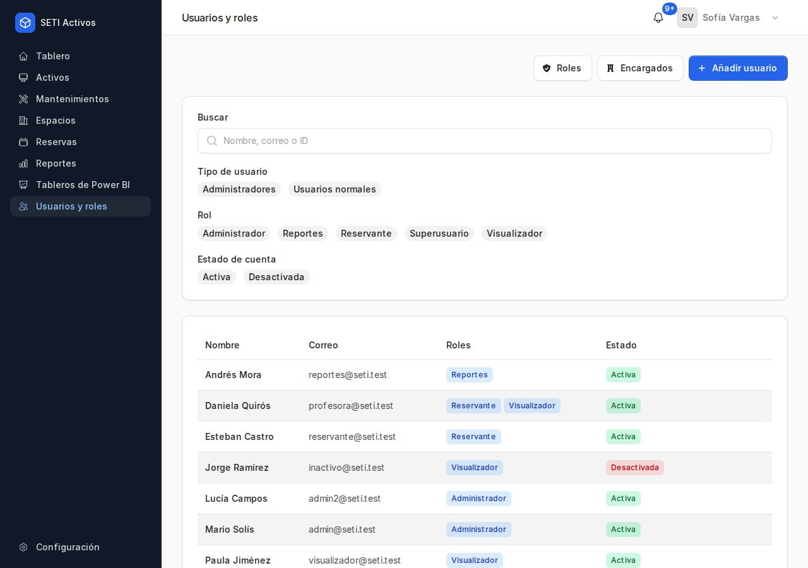
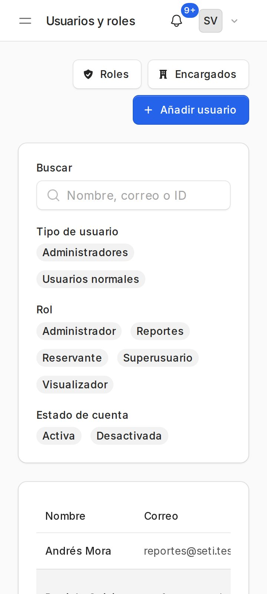

## Registrar un usuario (RF_91)

El **Superusuario** registra a cada persona; nadie puede crearse una cuenta por su cuenta.

1. En **Usuarios y roles**, pulsa **Añadir usuario**.
2. Escribe el **Nombre** y el **Correo** de la persona, y marca uno o varios **Roles**. Cada rol muestra debajo qué
   permite.
3. Pulsa **Registrar**. Un aviso confirma "Se registró a … y se envió la invitación a …", y la persona aparece en el
   listado con la insignia **Invitación pendiente**.

La persona recibe el correo **Tu invitación a SETI Activos**. Al pulsar **Definir contraseña** elige su contraseña, su
correo queda verificado y ya puede iniciar sesión; desde entonces desaparece **Invitación pendiente**. El enlace vence
en 48 horas: si vence, la persona pide otro con **¿Olvidaste tu contraseña?** en la página de inicio de sesión. Si su
rol es Superusuario o Administrador, al ingresar por primera vez el sistema le pide activar la autenticación en dos
pasos.

El correo no puede estar registrado ya (no importan las mayúsculas) y hay que marcar al menos un rol; si falta algo,
el error aparece debajo del campo.

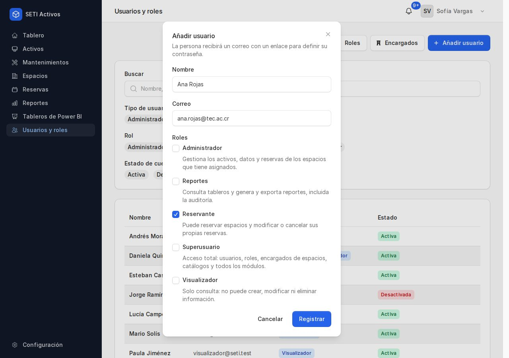
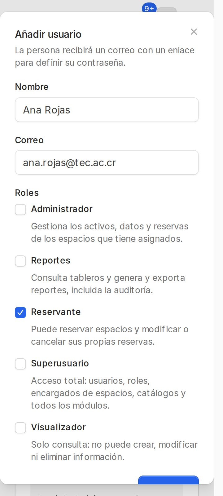

## Ficha de un usuario (RF_94)

La ficha muestra el nombre, el correo, los roles, el estado de la cuenta, el último inicio de sesión y la fecha de
registro; si la cuenta está desactivada, también desde cuándo. Un Administrador ve solo estos datos. El
Superusuario ve además las tarjetas para gestionar a la persona, que se explican abajo, y los botones **Editar** y
**Ver actividad**. **Volver a usuarios** regresa al listado.

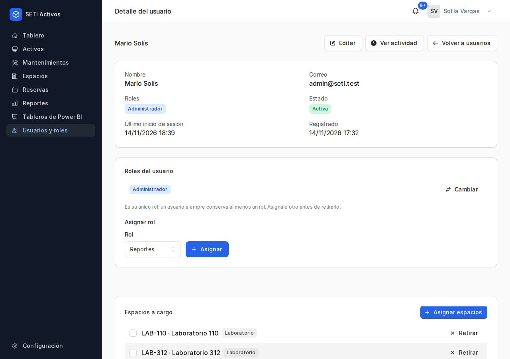
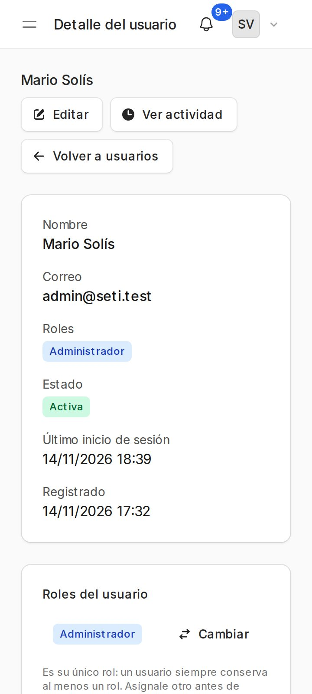

## Editar un usuario (RF_93)

1. En la ficha, pulsa **Editar**.
2. Cambia el **Nombre** o el **Correo** y pulsa **Guardar cambios**. **Cancelar** o **Volver al usuario** regresan a
   la ficha sin cambios.

El correo es el usuario para iniciar sesión. Si lo cambias, la persona recibe en el correo nuevo un enlace para
verificarlo. Si todavía no había aceptado su invitación, se le envía una invitación nueva a la dirección nueva.

## Asignar, cambiar y retirar roles (RF_85, RF_86, RF_87)

La tarjeta **Roles del usuario** de la ficha lista sus roles.

**Asignar.** En **Asignar rol**, elige el rol y pulsa **Asignar**. La lista solo ofrece los roles que la persona no
tiene todavía. Un aviso confirma "Se asignó el rol … a …".

**Cambiar.** Pulsa **Cambiar** junto al rol que quieres reemplazar y elige el **Nuevo rol**. Antes de confirmar, la
ventana muestra lo que la persona **Podrá además** y lo que **Dejará de poder**. Pulsa **Cambiar rol** para aplicarlo.

**Retirar.** Pulsa **Retirar** junto al rol. La ventana **¿Retirar el rol …?** muestra lo que la persona **Dejará de
poder** y, si retiras el rol Administrador, de qué espacios dejará de estar a cargo. Pulsa **Sí, retirar** o
**Cancelar**.

Los cambios se aplican de inmediato. Toda persona conserva al
menos un rol: con un solo rol no aparece **Retirar** y la tarjeta explica que primero hay que asignarle otro. Tampoco
se puede dejar al sistema sin Superusuario activo.

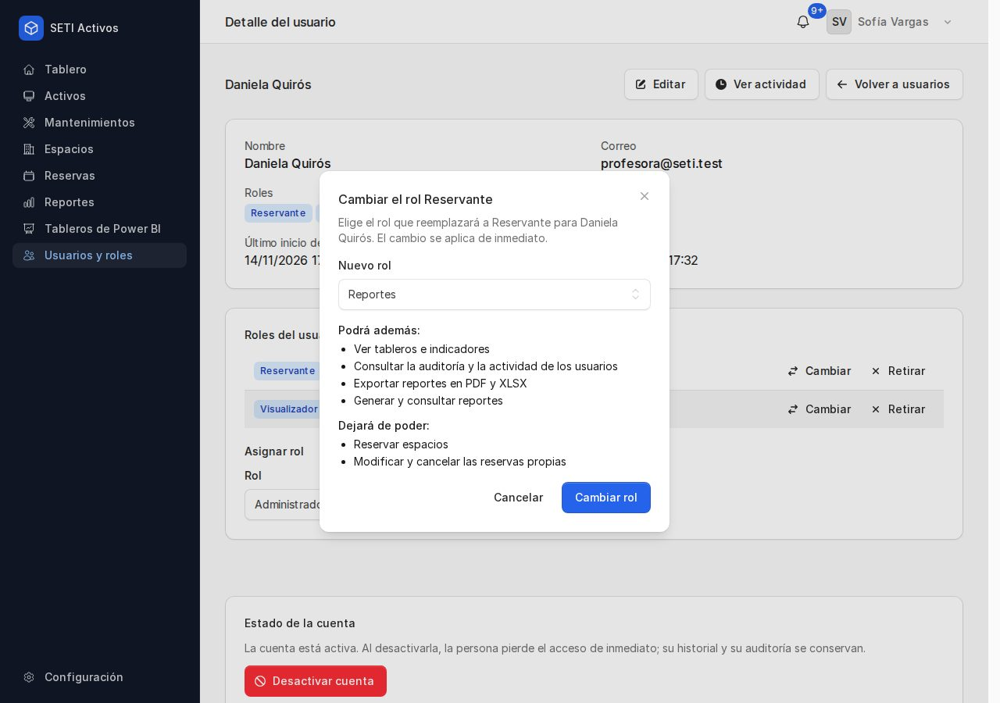
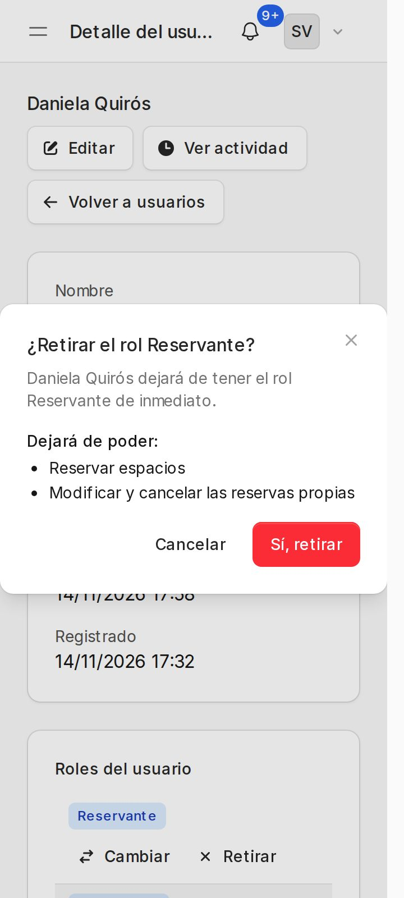

## Espacios a cargo de un Administrador (RF_40, RF_43)

La ficha de una persona con el rol Administrador tiene la tarjeta **Espacios a cargo**: los espacios cuyos datos,
activos y reservas gestiona.

**Asignar.** Pulsa **Asignar espacios**, elige uno o varios espacios y pulsa **Asignar**. Un aviso confirma los
espacios asignados.

**Retirar.** Pulsa **Retirar** en la fila de un espacio, o marca varios y pulsa **Retirar seleccionados**. En la
ventana **¿Retirar estas asignaciones?**, pulsa **Sí, retirar**. Si pulsas **Retirar seleccionados** sin marcar
ninguno, aparece "Elige al menos un espacio para retirar.".

Para ver qué Administradores están a cargo de un espacio, usa **Usuarios y roles → Encargados**
([manual](encargados-espacios.md)).

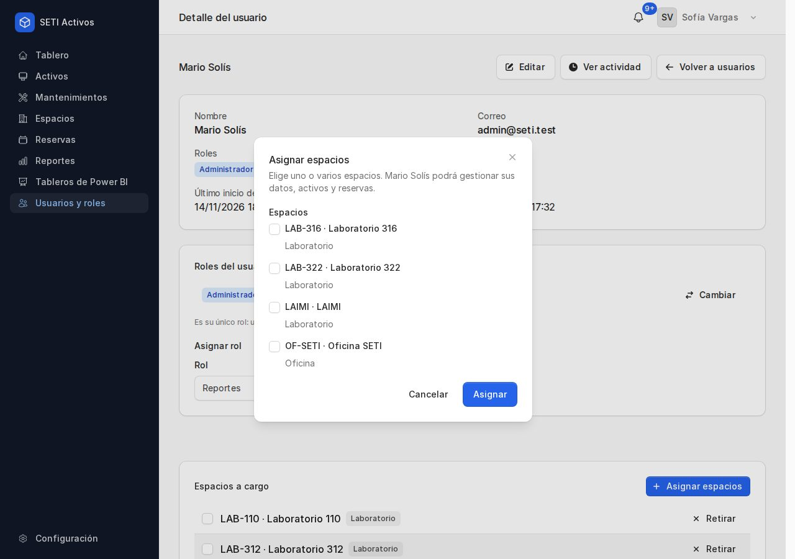
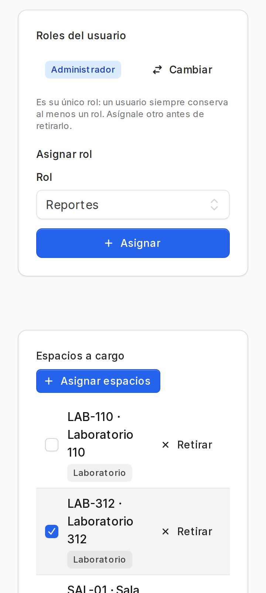

## Desactivar y reactivar una cuenta (RF_88, RF_98)

Desactivar sirve para que una persona que ya no trabaja con SETI deje de entrar, sin borrar nada: su historial, sus
reservas y su auditoría se conservan.

1. En la tarjeta **Estado de la cuenta** de la ficha, pulsa **Desactivar cuenta**.
2. En la ventana **¿Desactivar esta cuenta?**, pulsa **Sí, desactivar**. La persona no puede volver a iniciar sesión,
   sus sesiones abiertas se cierran y la tarjeta indica cuándo y quién desactivó la cuenta. Si intenta ingresar, ve
   "Tu cuenta está desactivada. Comunícate con el Superusuario del sistema.".
3. Para devolverle el acceso, pulsa **Reactivar cuenta** y luego **Sí, reactivar**. Entra de nuevo con su misma
   contraseña.

Nadie puede desactivar su propia cuenta, por eso en tu ficha no aparece el botón. Tampoco se puede desactivar al
último Superusuario activo.

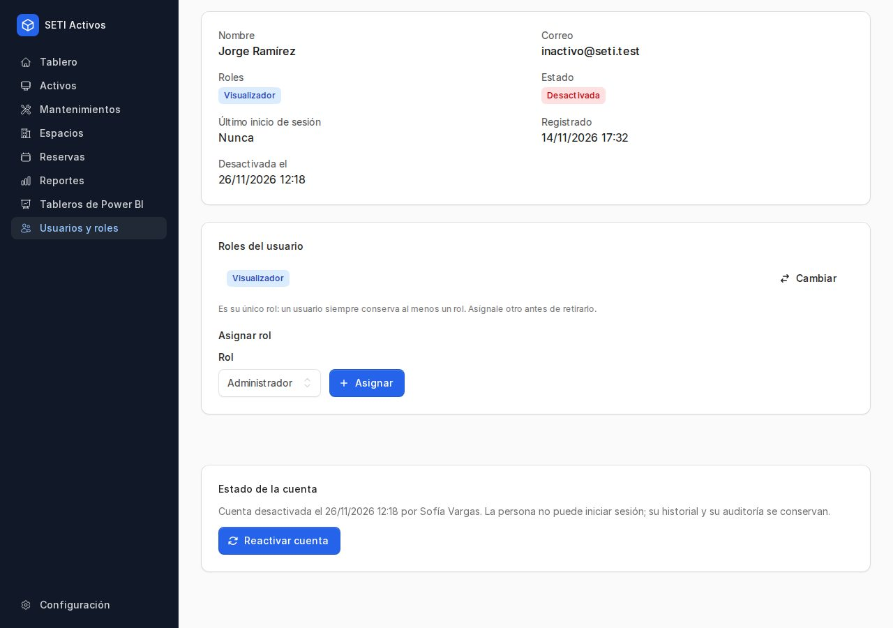
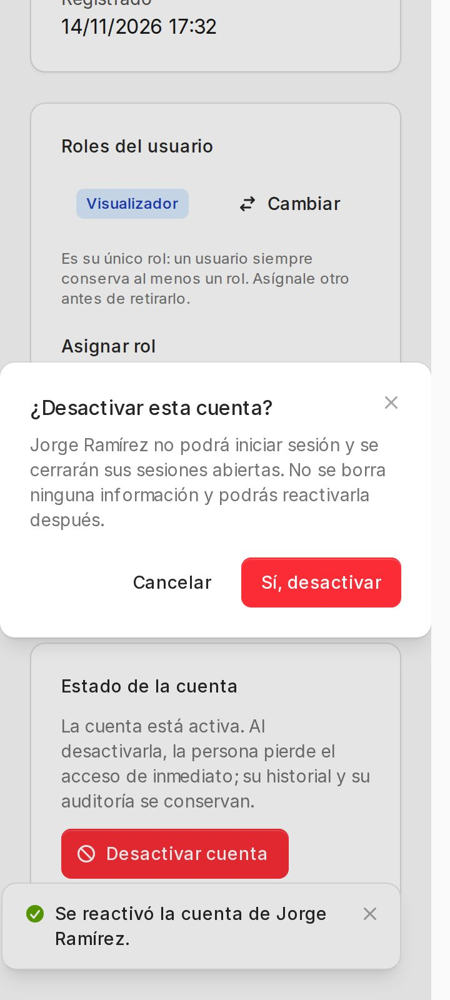

## Roles disponibles (RF_100)

**Usuarios y roles → Roles** muestra los cinco roles del sistema, cada uno con su descripción y cuántas personas lo
tienen. **Qué permite** despliega la lista de sus permisos y **Ver usuarios** muestra quiénes tienen el rol. Esta
página solo la ve el Superusuario.

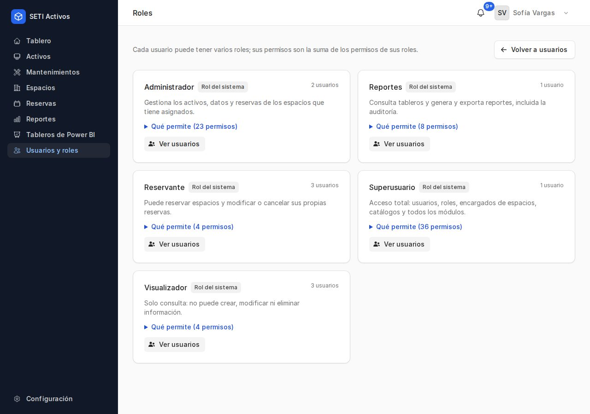
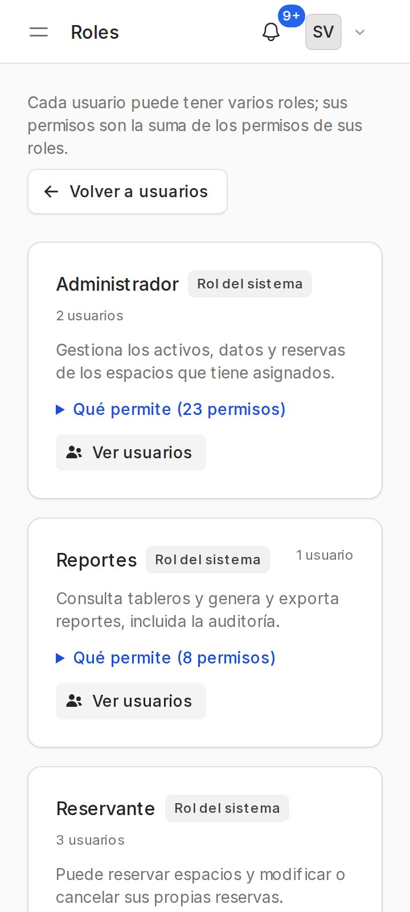

## Actividad de un usuario (RF_99)

**Actividad de usuarios** muestra lo que hizo una persona en el sistema: fecha, hora, operación (por ejemplo,
"Inició sesión", "Editó reserva") y el registro que tocó.

1. En la ficha de la persona, pulsa **Ver actividad**: la página se abre con ella ya elegida. También puedes abrir la
   página y elegir a la persona en **Usuario**.
2. Para ver solo un período, elige **Desde** y **Hasta**. **Quitar fechas** vuelve a toda su actividad.

La lista muestra 20 acciones por página, de la más reciente a la más antigua. Si la fecha final es anterior a la
inicial, aparece "La fecha final no puede ser anterior a la inicial.". La consultan el Superusuario y el rol
Reportes; por ahora el rol Reportes la abre con la dirección `/usuarios/actividad`.

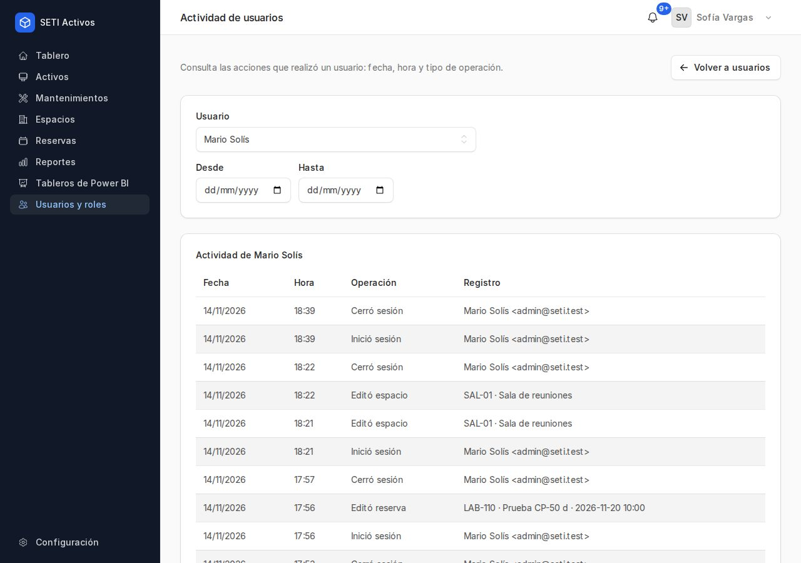
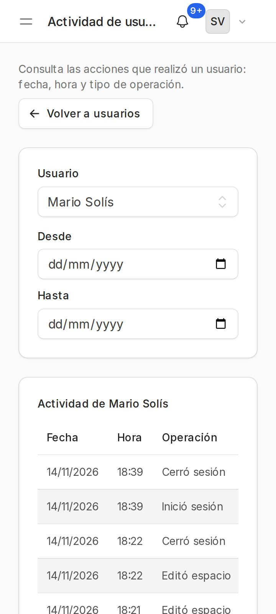
